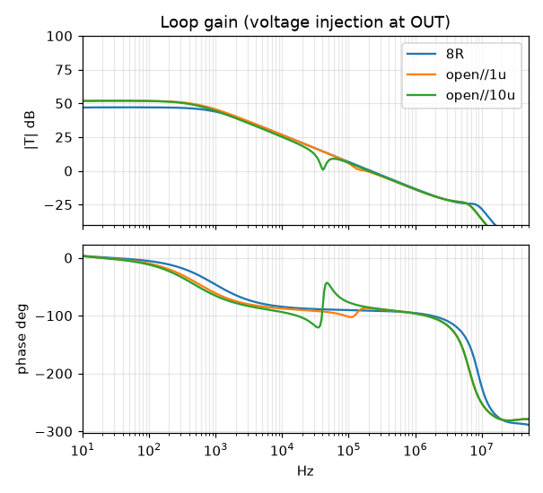
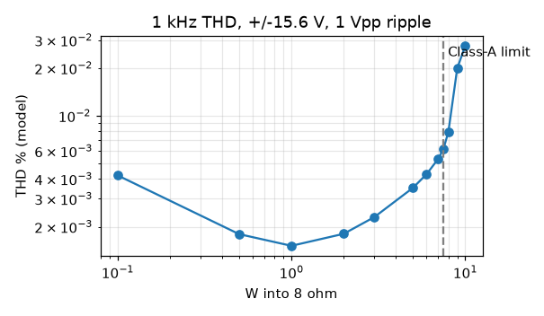
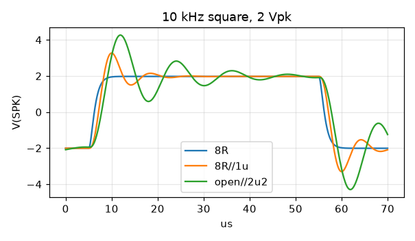
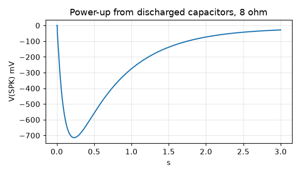

# ClassA2 Rev A — simulation record

All results come from ngspice 47 (the build bundled at `../MOSFETAmp2/tools/ngspice`). The deck is `simulation/amp.cir`; its connectivity and R/C/L values are checked against the KiCad netlist by `tools/verify_netlist.py`.

**Limits.** Every BJT model except BC546B/BC556B was fitted by hand to a few datasheet values: hFE at the test current, the VBE–IC curve, Cob and fT. They give realistic operating points and loop shapes. Absolute THD figures, exact phase margins and transient details are **estimates**, not hardware predictions. There is no self-heating; junction temperatures are imposed per device. Simulation does not establish hardware stability or thermal safety.

Reproduce with:

```bash
PYTHONPATH=/path/to/numpy+matplotlib python3 simulation/verify_all.py
```

The run takes about 30 s. Add `python3 simulation/psu.py` for the supply study and `python3 simulation/pdiss.py` for device dissipation. Raw results are in `simulation/results/summary.json`, and the plots are in `docs/plots/`.

Reference condition, unless stated: ±15.6 V rails, 8 Ω load, RV1 = 78 Ω (0.70 A), heatsink about 45 °C (sensor 46, drivers 48, output junctions 63 °C).

## DC

| Item | Result |
|---|---|
| Iq, upper / lower | 0.697 / 0.699 A |
| Output offset (RV2 centred) | −15.5 mV |
| Offset, RV2 end to end | +17.2 … −47.5 mV |
| VAS current | 5.49 mA each |
| Tail currents | 1.93 / 2.01 mA |
| V(bias spreader) | 1.686 V |
| Rail current per channel | 0.708 A |
| RV1 0 → 500 Ω | Iq 0.94 → 0.075 A |
| Heatsink 25/45/65 °C | Iq 0.738 / 0.697 / 0.657 A |
| Rails 14.0 / 15.6 / 20.2 V | Iq 0.687 / 0.697 / 0.722 A |

Bias sensitivity to each device group's temperature:

| Device group | Sensitivity |
|---|---|
| Sensor Q9 | −7.5 mA/K |
| Drivers | +5.2 mA/K |
| Outputs | +0.35 mA/K |

## AC and loop gain

| Item | Result |
|---|---|
| Closed-loop gain | 24.40 dB (16.6 V/V) |
| Response at 10 Hz / 20 Hz / 20 kHz | −0.10 / −0.03 / −0.07 dB |
| −3 dB points | 1.6 Hz, 149 kHz |
| Peaking | none |

Loop gain (voltage injection at OUT, before L1):

| Load | Crossover | Phase margin | Gain margin | T(1 kHz) | T(20 kHz) |
|---|---|---|---|---|---|
| 8 Ω | 206 kHz | 88.7° | 24.8 dB @ 7.9 MHz | 43.8 dB | 20.4 dB |
| 4 Ω | 206 kHz | 89.1° | 24.5 dB | 42.0 dB | 20.2 dB |
| open | 215 kHz | 88.5° | 25.3 dB | 45.6 dB | 20.6 dB |
| 8 Ω ∥ 1 µF | 179 kHz | 92.5° | 24.2 dB | 43.7 dB | 20.2 dB |
| open ∥ 100 nF | 215 kHz | 86.7° | 23.2 dB | 45.5 dB | 20.6 dB |
| open ∥ 470 nF | 179 kHz | 82.2° | 24.2 dB | 45.5 dB | 20.6 dB |
| open ∥ 2.2 µF | 188 kHz | 94.9° | 24.3 dB | 45.3 dB | 20.2 dB |
| open ∥ 10 µF | 196 kHz | 94.4° | 24.3 dB | 44.3 dB | 18.2 dB |



## Distortion and power

1 kHz into 8 Ω, ±15.6 V with 1 V p-p 100 Hz ripple. These figures include ripple leakage into the one-cycle Fourier window, which dominates at 0.1 W.

| Output | 0.1 W | 1 W | 3 W | 5 W | 7.5 W | 8 W | 10 W |
|---|---|---|---|---|---|---|---|
| THD % (model) | 0.0042 | 0.0015 | 0.0023 | 0.0035 | 0.0062 | 0.0079 | 0.028 |
| Minimum device current | 0.62 A | 0.45 A | 0.27 A | 0.14 A | 0.024 A | 0.007 A | ~0 |

Other distortion results:

| Case | 1 W | 5 W | 7.5 W | 10 W |
|---|---|---|---|---|
| 20 kHz, 8 Ω | 0.0035 % | 0.012 % | 0.022 % | — |
| 4 Ω (informative, AB above about 2 W) | 0.0024 % | 0.049 % | — | 0.049 % |

**Class-A limit: 7.5 W** (device current still above 20 mA). The theoretical limit is 7.8 W at 0.70 A.

Output at 1 % THD, 8 Ω:

| Supply | Output |
|---|---|
| Low mains, 10 mF (14.55 V, 1 V p-p) | 10.3 W (12.8 V pk) |
| Nominal, 10 mF | 12.0 W (13.9 V pk) |
| Nominal, 22 mF | 12.4 W |
| High mains, 10 mF | 15.2 W |

The 4 Ω capability (about 22 W at clipping) is not qualified for SOA or thermals.



## Transient

Square waves (10 kHz, 2 V pk):

| Load | Overshoot |
|---|---|
| 8 Ω, 4 Ω, open, open ∥ 100 nF | < 0.05 %, 10–90 % rise 1.5–2.8 µs |
| 8 Ω ∥ 1 µF | 32 % |
| open ∥ 470 n / 1 µ / 2.2 µ / 10 µF | 26 / 43 / 57 / 49 % |

The overshoot into large capacitors is the L1/R29 network resonating with the load capacitor (about 88 kHz into 2.2 µF), not loop instability.

Other transient results:

- **Slew rate (input RC filter bypassed):** +12.0 / −12.4 V/µs.
- **Without L1** (1 nH): open ∥ 100 nF oscillates continuously at about 1.9 MHz, 1.07 V p-p. **L1 is required.**



## Power cycling (from discharged capacitors, 8 Ω)

| Case | Output excursion | Iq maximum |
|---|---|---|
| Power-up, symmetric 40 ms ramp | −0.71 V at 230 ms; −28 mV at 3 s (still settling to trim point) | 0.71 A |
| Power-up, +rail 10 ms early | −0.72 V | 0.72 A |
| Power-down, 110 ms decay | +0.08 V | — |
| Power-down, −rail collapses first | −0.09 V | — |

There is no bias overshoot. The slow power-up excursion comes from C9/C1 charging, so speaker protection should hold off for at least 3 s.



## Gain spread (Iq at fixed RV1, offset, PM, THD at 5 W)

| Case | Iq | Offset | PM | THD 5 W |
|---|---|---|---|---|
| nominal | 0.697 A | −15.5 mV | 88.7° | 0.0033 % |
| outputs hFE 55 / 160 | 0.662 / 0.713 A | −15.5 mV | 88.9 / 88.7° | 0.0061 / 0.0029 % |
| outputs NPN 160, PNP 55 | 0.687 A | −16.9 mV | 88.8° | 0.017 % |
| drivers hFE 40 / 250 | 0.756 / 0.687 A | −15.5 mV | 89.0 / 88.7° | 0.0097 / 0.0024 % |
| VAS hFE 80 | 0.684 A | −15.2 mV | 88.8° | 0.0043 % |
| inputs GR200/BL700 · GR400/BL350 | 0.697 A | −21.6 / −12.1 mV | 88.9° | 0.0034 % |
| everything at minimum | 0.682 A | −20.3 mV | 90.0° | 0.023 % |

## Noise and dissipation

- **Noise:** 21.7 µV rms at the output over 20 Hz–20 kHz (1.31 µV referred to the input). That is 111 dB below 7.5 W.
- **Output-device dissipation:** 10.55 W each at idle, 8.7 W at 3.75 W out, 6.8 W at 7.5 W, 5.3 W at 12 W. Into 4 Ω: 7.8 W at 10 W.

## PSU

See [DESIGN.md §5](DESIGN.md#5-power-supply-12-0-12-vac-100-va-both-channels) and `simulation/results/psu_summary.json`.
