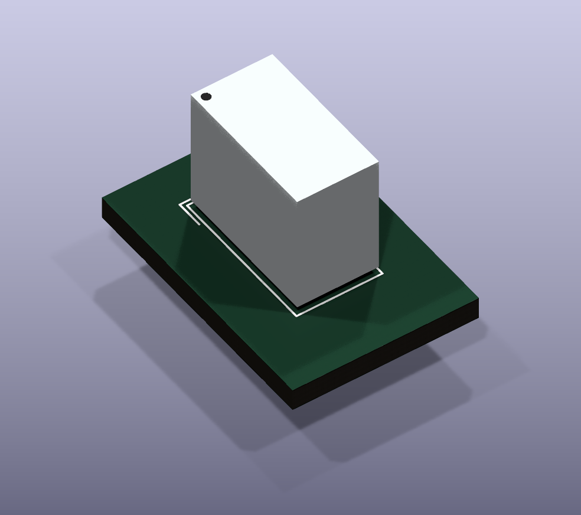
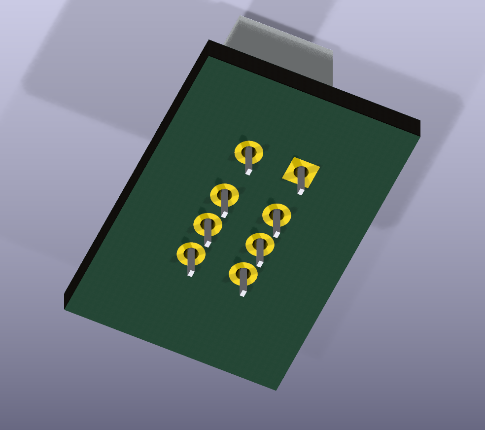

# NAIS / Panasonic AGN2004H footprint and model

AGN2004H has the same electrical pin functions as the G6K-2P-Y used in this project. Both are polarised, single-side-stable DPDT relays. Their pin-row spacing, coil voltage and body dimensions differ, so AGN2004H is not a mechanical drop-in replacement.

| Item | Panasonic / NAIS AGN2004H | Omron G6K-2P-Y |
| --- | --- | --- |
| Distance between pin rows | 3.2 mm | 5.08 mm |
| Pitch along each row, from coil end | 3.2, 2.2, 2.2 mm | 3.2, 2.2, 2.2 mm |
| Coil | 1 positive, 8 negative | 1 positive, 8 negative |
| COM | 3 and 6 | 3 and 6 |
| NC (de-energised) | 2 and 7 | 2 and 7 |
| NO | 4 and 5 | 4 and 5 |
| Nominal case length / width | 10.6 / 5.7 mm | 10 / 6.5 mm |
| Nominal mounted height | 9 mm | 5 mm |
| Coil voltage | 4.5 V | 5 V in the project symbol |

Sources visually checked: [Panasonic GN catalog, ASCTB13E 202603](https://industry.panasonic.com/ac/cdn/e/control/relay/signal/catalog/mech_eng_gn.pdf), PDF pages 2-4 and 8 (printed pages 1-3 and 7); [Omron G6K datasheet](https://omronfs.omron.com/en_US/ecb/products/pdf/en-g6k.pdf), page 6, G6K-2P-Y drawing. Both THT pin diagrams are bottom views; the new footprint is the corresponding top view.

In Panasonic's schematic the moving arms originate at pins 3 and 6, making those COM. The filled dots at pins 2 and 7 indicate the contacts closed when de-energised (NC). Thus 2-3 and 6-7 close with the coil off; 3-4 and 5-6 close with the coil energised. This agrees with the user's continuity checks on the salvaged relays.

AGN2004H is the standard 140 mW coil version, rated 31 mA and 145 ohms +/-10% at 20 C in the current catalog. The suffix 4H means 4.5 V; high sensitivity is the AGN2604H part. Maximum initial pickup at 20 C is 3.375 V (75% of 4.5 V). Panasonic recommends operating within +/-5% of nominal coil voltage. These are manufacturer specifications, not measurements of the six salvaged relays.

## Created assets

- `InputSwitch:Relay_DPDT_Panasonic_AGN2004H`, in `InputSwitch.pretty/Relay_DPDT_Panasonic_AGN2004H.kicad_mod`.
- `InputSwitch.3dshapes/Relay_DPDT_Panasonic_AGN2004H.step`, already linked from the footprint with `${KIPRJMOD}`. Scale 1; offset and rotation 0.
- `scripts/build_agn2004h.py`, the reproducible generator.

The existing project-local `InputSwitch` library registration already makes this footprint available. Reload the library listing if an open footprint chooser has cached it. No library-table edit is needed.

The footprint preserves actual Panasonic terminal numbers. With pin 1 as origin, coordinates in mm are:

| Pin | X | Y | Function |
| --- | ---: | ---: | --- |
| 1 | 0 | 0 | Coil + |
| 2 | 0 | 3.2 | NC A |
| 3 | 0 | 5.4 | COM A |
| 4 | 0 | 7.6 | NO A |
| 5 | 3.2 | 7.6 | NO B |
| 6 | 3.2 | 5.4 | COM B |
| 7 | 3.2 | 3.2 | NC B |
| 8 | 3.2 | 0 | Coil - |

All holes are 0.85 mm, following Panasonic's recommended pattern. Copper pads are 1.6 mm, providing a nominal 0.375 mm annular ring. Pin 1 is square. Fabrication outline is the nominal case with a conventional pin-1 chamfer indicator; silkscreen includes an external pin-1 mark. The closed courtyard accommodates maximum 6.0 x 10.9 mm case dimensions plus 0.25 mm clearance on each side.

The STEP is a simplified nominal mechanical envelope, with a 10.6 x 5.7 mm case, 0.5 mm nominal standoff, 9 mm mounted height, and eight 0.4 x 0.25 mm blade terminals extending 3.5 mm below the board surface. The direction dot is a cosmetic representation raised 0.005 mm above the case to prevent coincident faces in renderers. Mold details, inscriptions and lead-tip shape are omitted. Allow 9.3 mm maximum mounted case height for enclosure clearance.

## Verification and limits

- KiCad 10.0.5 loads the footprint; all eight pad numbers, coordinates and 0.85 mm drills were independently asserted through `pcbnew`.
- Isolated verification board: zero DRC violations and zero unconnected items; see `footprint-drc.rpt`. Pads on this board have no assigned nets. This is a footprint geometry check, not validation of InputSwitch connectivity. KiCad's default ignored check categories are listed in that report; no exclusions were added.
- STEP imported and re-exported through KiCad's OpenCascade exporter. KiCad rendered both top and underside views; visual inspection confirmed orientation and all eight pins centred in their holes.
- Every pre-existing root schematic, PCB, project/settings file, library table, footprint and STEP model included in the before/after SHA-256 snapshots remained byte-identical. See `source-hashes-before.json` and `source-hashes-after.json`.
- No existing relay assignments, symbols, tracks, settings or electrical topology were changed. ERC and full InputSwitch DRC were not rerun because the design itself was not edited.
- Bench-test the salvaged parts for coil resistance, correct-polarity pickup/dropout, and COM/NC/NO continuity. Datasheet comparison cannot establish their condition.

The existing `G6K_5V` symbol's electrical pin mapping is compatible: COM 3/6, NC 2/7, NO 4/5 and coil 1+/8-. Its part identity, value, coil-voltage description and footprint assignment would need updating for AGN2004H. The contact pin mapping does not need changing. The different pin-row spacing requires a PCB placement/routing update. No such design edits have been made.

Additional observation: the three G6K footprints embedded in the current PCB, and the installed KiCad G6K-2P-Y library footprint, put pins 2/7 at Y=3.0 mm; Omron's drawing gives 3.2 mm. That existing 0.2 mm discrepancy was left unchanged. The Panasonic footprint uses its published 3.2 mm position.

