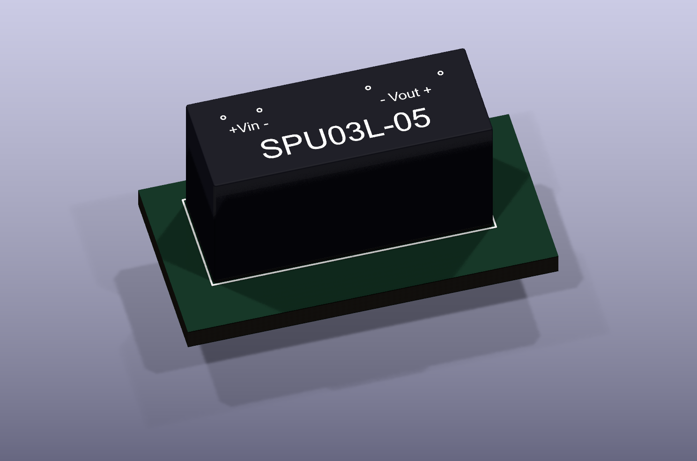

# SPU03L-05 detailed KiCad model

Created 9 October 2026. Black case with rounded edges, a base seam, white part number and terminal markings, and four silver blade leads.

The geometry uses the [MEAN WELL SPU03 datasheet](https://www.meanwell.com/Upload/PDF/SPU03/SPU03-SPEC.PDF), revision 2024-08-02, page 1. Its product photograph guided the appearance. Nominal case dimensions are 19.6 × 7.5 × 10.2 mm; leads are 0.50 × 0.30 mm with 3.81 mm length below the case. Pin numbers 1, 2, 5 and 7 are retained. Their centres are X = 0, 2.54, 10.16 and 15.24 mm, Y = 0. The body extends X = -2.18 to 17.42 mm and KiCad Y = -1.20 to 6.30 mm, matching the existing footprint. STEP Y is the inverse of KiCad Y.

## Installed files

- `InputSwitch.3dshapes/SPU03L-05.step` contains the detailed model.
- `/Users/tomwatson/Downloads/SPU03L-05.step` was updated to the same model, because U10 and U11 already reference this exact path. Their scale, offsets and rotations remain unchanged. Close and reopen the 3D Viewer to reload the file; if it retains its cached model, close and reopen the PCB editor without discarding unsaved work.
- The original models are backed up in `source/project-original.step` and `source/downloads-original.step`.
- `scripts/build_spu03_model.py` is the reproducible CadQuery generator.

The PCB, schematic, project/settings and existing footprint files were not edited. The before/after hashes document this. The existing board keeps its Downloads model path. For portable projects, the optional packaged footprint references `${KIPRJMOD}/InputSwitch.3dshapes/SPU03L-05.step` at scale 1 and zero offset/rotation. Its pads and outlines are copied from the existing footprint. Extract the package into a project folder and use the included model with the existing project-local library registration, or assign that path manually in Footprint Properties → 3D Models. Updating a library footprint does not automatically update footprints already embedded in a board.

## Verification

- CadQuery imported the exported STEP as valid geometry. Nominal body envelope and four pin centres were asserted; see `geometry-validation.json`.
- KiCad 10.0.5 parsed the existing footprint, verified all pad centres and 0.9 mm drills, and imported/re-exported the STEP successfully. The resulting assembly also imported as valid CAD geometry.
- KiCad rendered the detailed model from above and below. All four leads are centred in the footprint holes; see `preview.png` and `pin-preview.png`.
- Isolated footprint verification board: 0 DRC violations and 0 unconnected items. This is a pad/body alignment check, not a full InputSwitch board qualification. No DRC exclusions were added. Full-board DRC and schematic ERC were not rerun because only model files changed.

## Physical limits

This is an independently created visual model, not manufacturer-certified production CAD. Corner radii, seam, potting appearance, lead chamfers, lettering font/placement and printed circles are cosmetic approximations. Text is represented by 0.006 mm thick white solids, with its top 0.0065 mm above the nominal case. The case sits at PCB Z = 0, preserving the old model's mounting height; assembly seating can introduce an additional gap. Confirm tolerances, seating height and enclosure clearances against the actual part before relying on it for close mechanical fits. Internal circuitry is not modelled. Electrical design and fabrication readiness were not reassessed.

