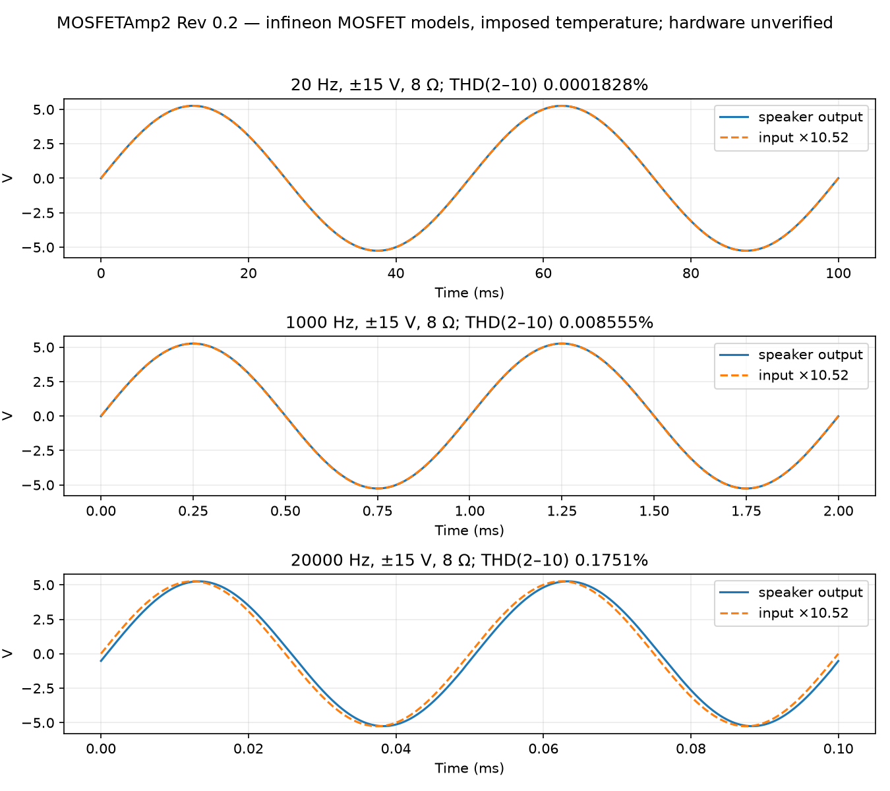
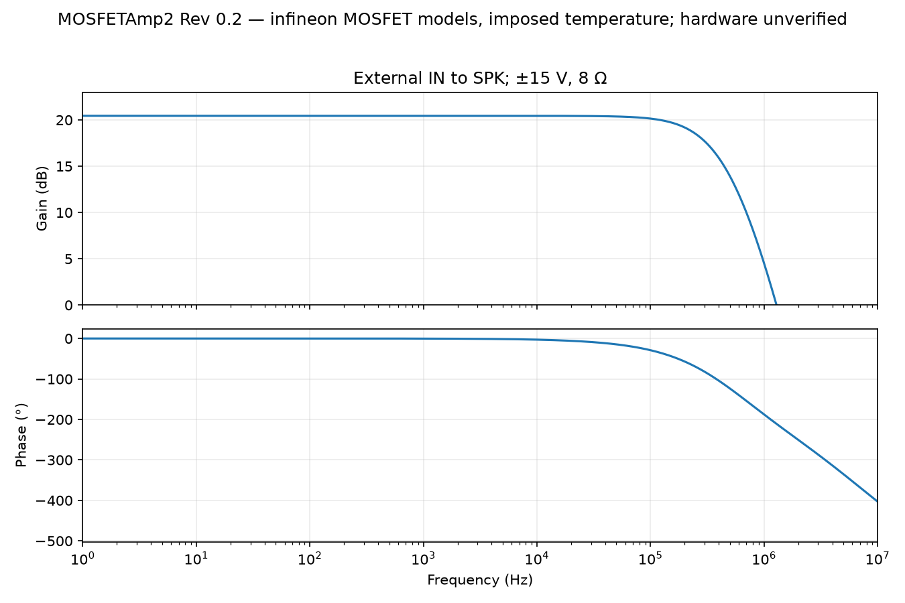
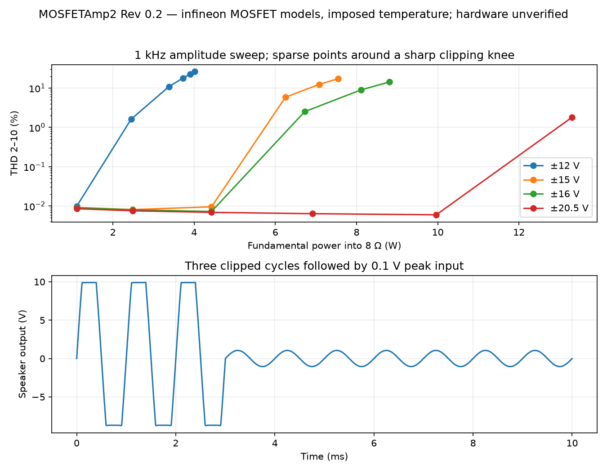
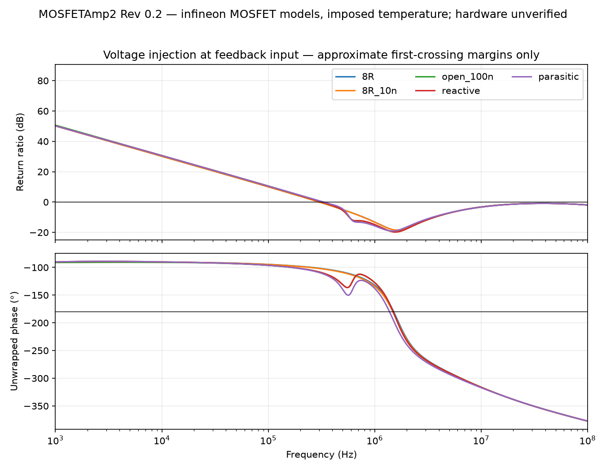
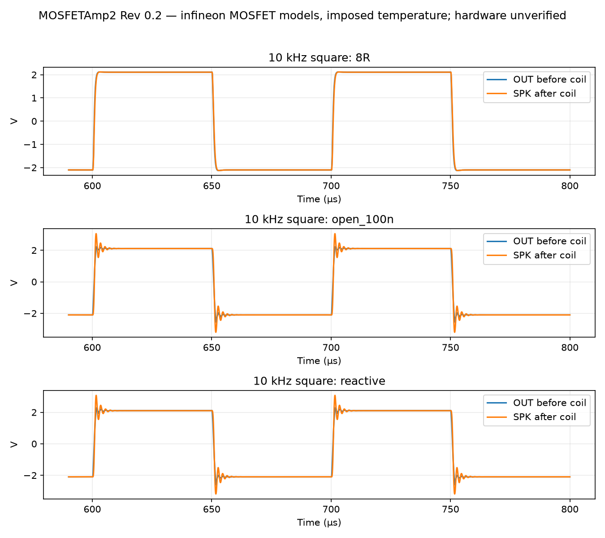
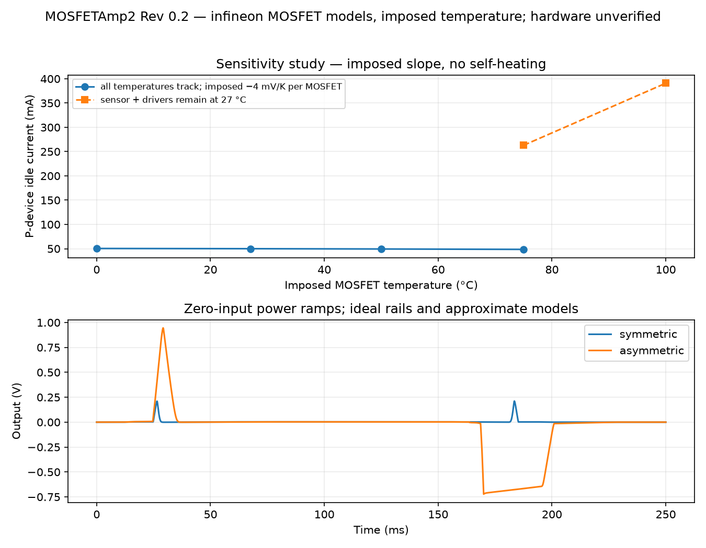

# Simulation results — ngspice 47, Rev 0.2

**These are circuit-development results, not measured amplifier specifications.** MOSFET models: **infineon** (`simulation/models/mosfets_infineon.lib`). The default is the Infineon MODPEX IRF540N/IRF9540N subcircuits, which are manufacturer models but contain no threshold temperature coefficient, subthreshold, spread or SOA behaviour; temperature and spread are imposed through gate series sources and KP scaling. BD139/BD140, BAT46, Zener and LED models are author approximations. The BC546B/BC556B models came from the installed LTspice NXP library, not the stocked ST/onsemi devices. Provenance is in `simulation/models/README.md`. Rev 0.1 results (authored MOSFET models, Zener bias network) are archived in `work/rev0.1/results/`. The circuit uses 330 pF compensation and the Rev 0.2 bias network: two board diodes, a fixed 3k9/1k0 sensor multiplier and an LED-referenced offset current set by R114 (nominal 1k0) plus a 200 Ω trim; see `docs/BIAS_STUDY.md`. No output short-circuit limiter is present.

## Operating points

The nominal model, with R114 = 1k0, was adjusted to 50 mA P-device current at ±15 V: numerical trim 128.19 Ω of 200 Ω. **Do not use that number as a construction setting.** All rail sweeps below retain that one adjustment.

| Rails | Output DC | Iq N / P | + / − rail current magnitude | Idle input power/channel |
|---|---:|---:|---:|---:|
| ±12 V | 1.82 mV | 35.5 / 35.2 mA | 47.5 / 47.3 mA | 1.14 W |
| ±15 V | 2.87 mV | 50.5 / 50.0 mA | 63.3 / 62.9 mA | 1.89 W |
| ±16 V | 3.20 mV | 55.2 / 54.7 mA | 68.3 / 67.9 mA | 2.18 W |
| ±20.5 V | 4.57 mV | 75.1 / 74.4 mA | 89.3 / 88.8 mA | 3.65 W |

## Sines, gain and distortion

±15 V, 8 Ω, 0.5 V peak external input; fitting the final three cycles to harmonics 1–10. THD here is harmonics 2–10 divided by the fundamental; it is not THD+N. Adaptive transient samples are uniformly resampled and fitted by least squares. A residual column is recorded in JSON to expose fitting/numerical error. The tiny low-frequency figure is strongly model-dependent and must not be advertised as hardware performance.

| Frequency | Fundamental Vpk | Power | Gain | THD 2–10 |
|---|---:|---:|---:|---:|
| 20 Hz | 5.261 V | 1.730 W | 10.521 | 0.00018284% |
| 1000 Hz | 5.261 V | 1.730 W | 10.521 | 0.0085552% |
| 20000 Hz | 5.255 V | 1.726 W | 10.510 | 0.17507% |

AC gain at 1 kHz is 20.441 dB. Relative to that, 20 Hz is +0.00003 dB and 20 kHz -0.0111 dB. DC coupling creates no intentional low-frequency high-pass pole. Nominal maximum simulated output slopes are +11.86/−5.40 V/µs. A 10 V peak/20 kHz sine requires 1.26 V/µs. The slope test is a 1 kHz, 0.7 V peak input square wave; it does not characterize every clipping condition.





## Clipping power and headroom

1 kHz, stiff symmetric rails, 8 Ω. Binary search uses eight iterations over input amplitude; entries are the last sample below the stated THD threshold, not exact clipping boundaries. Power uses the fundamental, Vpk²/16. The 0.1% column is the conservative approximate useful-output estimate; the 1% column includes clipping. Real rails, device spread and temperature can reduce it.

| Rails | Vpk at <0.1% | Power at <0.1% | Power at <1% | Efficiency at <0.1% |
|---|---:|---:|---:|---:|
| ±12 V | 5.80 V | 2.10 W | 2.32 W | 35.8% |
| ±15 V | 8.58 V | 4.60 W | 5.03 W | 43.0% |
| ±16 V | 9.56 V | 5.71 W | 6.19 W | 45.1% |
| ±18 V | 11.41 V | 8.14 W | 8.78 W | 48.0% |
| ±20.5 V | 13.75 V | 11.82 W | 12.69 W | 51.1% |
| ±21 V | 14.24 V | 12.68 W | 13.58 W | 51.7% |

The ±20.5/21 V rows are supply-stress feasibility cases, not continuous stereo output ratings or SOA approval. A real 12-0-12 VAC supply is expected to support a more modest nominal output, depending on ripple valleys and regulation. See `DESIGN.md`.



## Loop and reactive loading

AC voltage injection splits the feedback input between the divider and Q101 base, retaining its DC bias. Return-ratio estimate is `−V(FB)/V(FBI)`. The finite impedances and other feedthrough paths make this an approximate voltage-injection result. It is **not** a complete two-injection/Tian return-ratio proof. The voltage-injection ratio approaches unity again at very high frequencies, where feedthrough and finite injection impedances make its interpretation unreliable; quoting only the first margin cannot certify broadband stability. Fixed MOSFET gate capacitances and approximate BJT bandwidths are further limitations.

| Load | First crossover | Approximate first-crossing phase margin |
|---|---:|---:|
| 8R | 301.8 kHz | 78.5° |
| 4R | 289.1 kHz | 79.8° |
| 8R_10n | 301.5 kHz | 78.1° |
| open_100n | 319.7 kHz | 70.3° |
| reactive | 319.7 kHz | 70.4° |
| reactive + selected parasitics | 333.4 kHz | 67.9° |

`8R_10n` = 8 Ω || 10 nF; `open_100n` = 1 MΩ || 100 nF; `reactive` = (8 Ω + 0.5 mH series) || 100 nF. The selected parasitic case adds 30 nH external gate inductance, 10 nH MOSFET source inductance, 100 nH per wirewound source resistor, 10 nH film-bypass ESL and 0.1 Ω bulk-capacitor ESR. These are chosen estimates, not extracted PCB/component models. A second test doubles lumped Cgs/Cgd under an 8 Ω || 100 nF load. The final output coil is ideal in the base model; its estimated 8–10 mΩ DCR is not included.

The 10 kHz square tests use 0.2 V peak input and 200 ns edges. Saved waveforms show settling under all tested loads. With a nearly open 100 nF load, the external coil/capacitor resonance produces substantial post-coil overshoot; this is not a clean-square-wave claim. The 8 Ω/10 nF case is much better damped. Inspect OUT and SPK separately. The numerical envelope below is taken after 0.6 ms; it does not establish absence of oscillation on a real PCB.

| 10 kHz load | SPK minimum / maximum |
|---|---:|
| 8R | -2.127 / 2.118 V |
| 4R | -2.114 / 2.113 V |
| 8R_10n | -2.130 / 2.119 V |
| open_100n | -3.201 / 3.052 V |
| reactive | -3.185 / 3.076 V |

4 Ω is an analysis comparison only; this revision has no 4 Ω operating rating. Extreme capacitance and parasitic tests do not close the unknown hot-SOA issue. PCB parasitics, real gate charge and full-bandwidth bench square-wave tests remain required.





## Bias, temperature and tolerance

There is no thermal-feedback/self-heating simulation. MOSFET threshold magnitude is shifted by −4 mV/K through gate series sources and KP by (T/300.15 K)^−1.5; the MOSFET models themselves stay at 27 °C. The sensor temperature (Q108) and the driver/board bias-part temperature (D109, D112, D113, Q116, Q117, Q109, Q110) are assigned separately. Input-pair/reference-device temperatures are nominal. These are sensitivity experiments, not a calibrated electrothermal model. The −4 mV/K slope is assumed; the full −3/−4.7/−6 mV/K, device-corner and thermal-lag comparison is in `docs/BIAS_STUDY.md`.

| Imposed condition | Iq P |
|---|---:|
| junction0_sensor0_driver0 | 50.5 mA |
| junction27_sensor27_driver27 | 50.0 mA |
| junction50_sensor50_driver50 | 49.4 mA |
| junction75_sensor75_driver75 | 48.6 mA |
| junction100_sensor75_driver75 | 143.6 mA |
| junction75_sensor27_driver27 | 262.9 mA |
| junction100_sensor27_driver27 | 390.9 mA |

At 75 °C with matched sensor/driver temperatures, imposing −2/−4/−6 mV/K per MOSFET gives respectively 0.09 mA, 48.59 mA, 147.62 mA. The default slope-select resistor (R113 = 1k0) suits about −4.7 mV/K; a −2 mV/K device is therefore over-compensated (bias falls) and −6 mV/K under-compensated. R113 must be chosen from the measured slope. With the LED forward-voltage coefficient changed to about −1.5 or −2.5 mV/K (all parts at 75 °C) the current is 71.9 or 13.0 mA, against 48.6 mA nominal.

| Fixed-adjustment corner | Iq P |
|---|---:|
| bias_R_high | 117.0 mA |
| bias_R_low | 6.7 mA |
| input_1mV | 49.6 mA |
| BD_beta_25 | 312.8 mA |
| BD_beta_250 | 16.5 mA |
| rheostat_0 | 391.23 mA |
| rheostat_200 | 0.08 mA |
| rheostat_1000000000.0 | 0.02 mA |
| RE_unfitted | 0.02 mA |
| vth_-0.5_-0.5 | 812.73 mA |
| vth_-0.5_0.5 | 50.12 mA |
| vth_0.5_-0.5 | 50.29 mA |
| vth_0.5_0.5 | 0.07 mA |

Lowest datasheet thresholds (2 V / 2 V): with R114 unfitted (first bias power-up) the model gives 0.03 mA. Selecting R114 = 6.2k with a 2k trim at 84 Ω gives 50.0 mA. Under the same imposed warm condition that failed in Rev 0.1 (−4 mV/K, 75 °C, sensor and drivers tracking; 48.8 → 262.5 mA there) this pair now gives **39.0 mA**. The fixed multiplier ratio no longer depends on the device threshold. This rests on the imposed slope and on R113 matching the real devices; it is not bench evidence. RE unfitted or an open trimmer gives minimum bias. A shorted trimmer, an open LED or a shorted Q116 can overbias the pair (see `docs/BIAS_STUDY.md` failure table). Fit the bias-short header for the first power check and follow the current-limited commissioning procedure.



## Startup and overload

- Symmetric ideal rail ramps: output minimum -0.001 V, maximum 0.211 V.
- Asymmetric ideal rail ramps: output minimum -0.722 V, maximum 0.945 V.
- After three clipped 1 kHz cycles followed by 0.1 V peak input, the last-three-cycle fit returns 1.052 V peak output, 2.87 mV DC and 0.0098% model THD.
- With BP–BN shorted and load disconnected, initial ±8/12/15 V models draw approximately 9.1/10.4/11.2 mA per rail and essentially zero MOSFET current (0.001/0.001/0.001 mA). This verifies the intended first-power condition in the nominal models.

Startup sources use explicit PWL ramps with initially discharged capacitors. They omit actual bench-supply current limiting, bridge/reservoir charging, relay action and real semiconductor failure modes. External speaker muting/protection must be verified with the actual PSU.

## Unresolved verification and release gates

1. Infineon MOSFET models are now used, but they lack thermal/subthreshold behaviour; BD139/BD140 models remain approximations. Actual hi-fi THD/noise is unmeasured; no noise specification is claimed.
2. Measure each MOSFET's VGS at 50 mA and its slope with temperature (fixture in `docs/BIAS_STUDY.md`), select R113 and R114, and demonstrate stable cold/warm idle and signal-to-idle recovery on the real heatsink. Bias also rises by roughly half between the low and high rail scenarios; this rail sensitivity is common to Rev 0.1 and Rev 0.2 and is not yet resolved.
3. Establish hot linear-mode SOA for repetitive low-frequency and intended reactive loads. The published 10 ms pulse curves do not guarantee DC or 20 Hz service. Analytical average thermal margins do not close this item.
4. Measure heatsink/interface performance, supply extremes/ripple and external speaker-protection behaviour. No output-short or 4 Ω rating is implied.
5. Resolve physical pot/resistor/coil fits, lay out the board, inspect current paths and run DRC. Real full-bandwidth oscillation and thermal tests remain mandatory.

## Reproduction and saved evidence

Run from the project root with Python 3.11+ and `numpy scipy matplotlib` installed:

```sh
python3 simulation/run.py
python3 simulation/extended.py
python3 simulation/supplement.py
python3 tools/plot_results.py
python3 tools/report_results.py
```

The trimmer endpoint (0 Ω) is a finite setting in Rev 0.2 because R114 remains in series; its current is listed in the tolerance table as a warning about the trim range, not a precise physical prediction. Set `MOSFET_MODELS=authored` to rerun with the Rev 0.1 authored MOSFET approximations.

The scripts use the project-local ngspice executable; set `NGSPICE` to another compatible ngspice 47 path if needed. Bundled executable is macOS arm64. The scripts require only local files and do not query or modify inventory. Individual generated decks are in `simulation/results/`; their include paths assume the simulation directory as working directory. `.txt.gz` files are the losslessly compressed numeric traces, readable by NumPy or gzip; a rerun writes fresh uncompressed `.txt`. Logs and the three JSON summaries are retained. Figures are generated from those traces. A source/result checksum manifest accompanies the final evidence.
