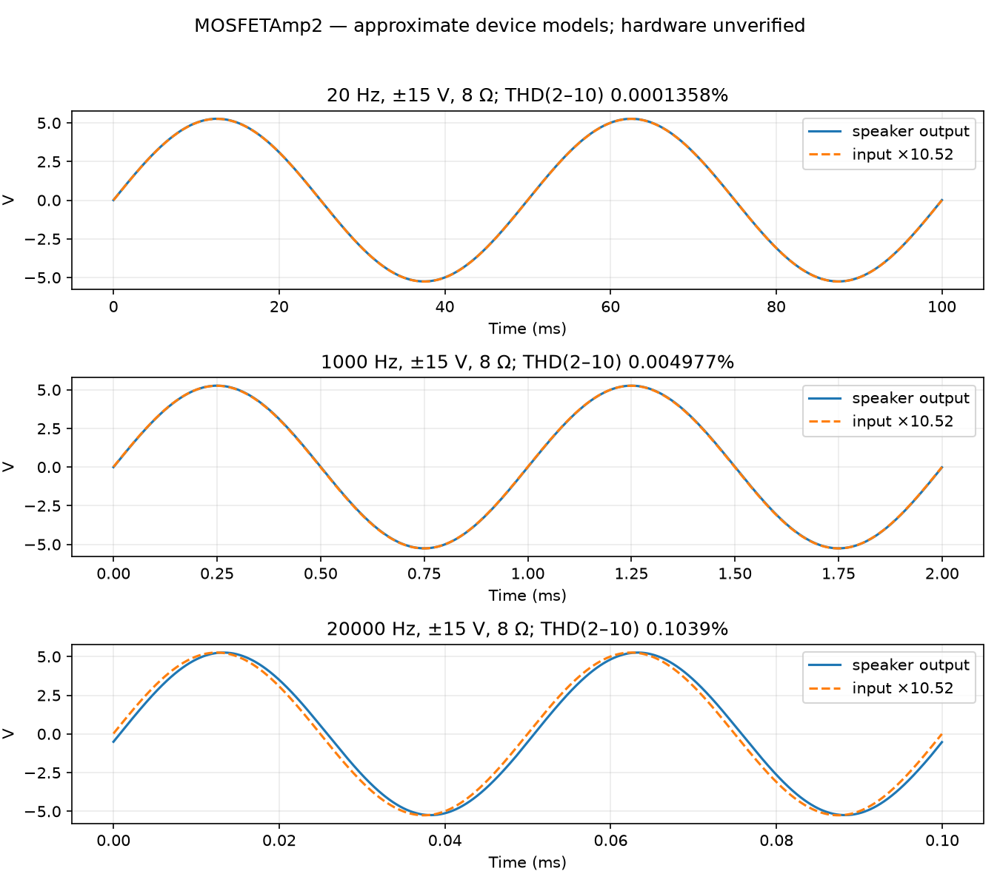
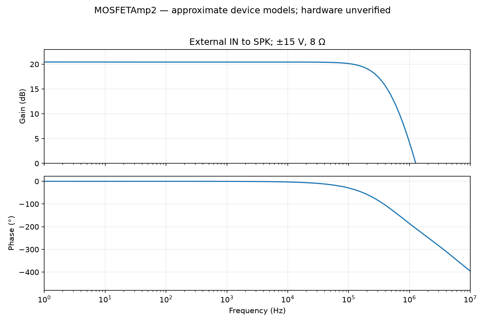
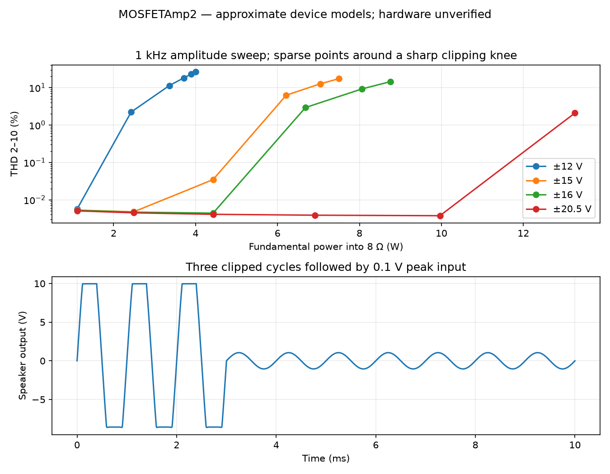
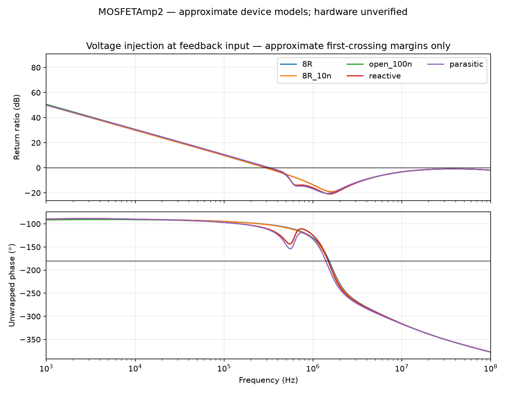
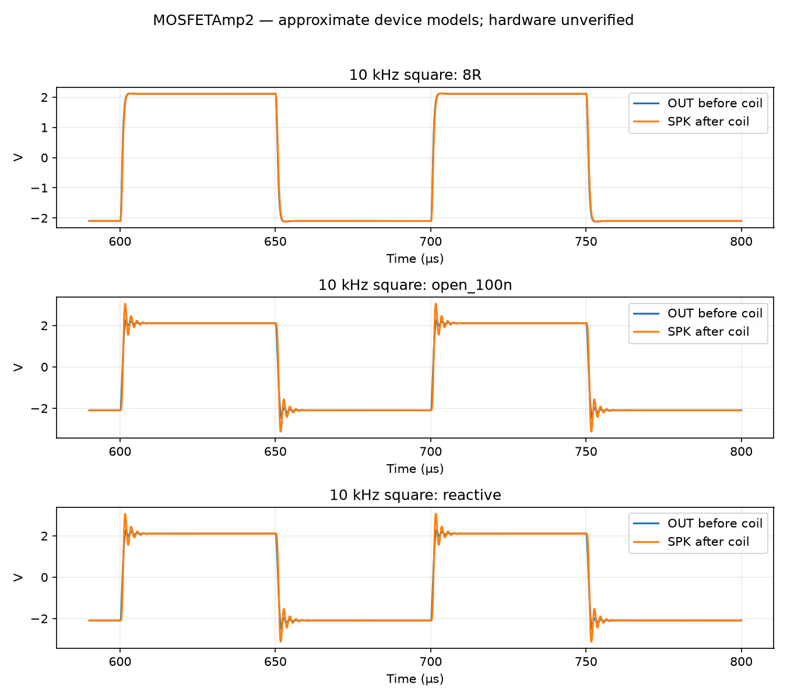
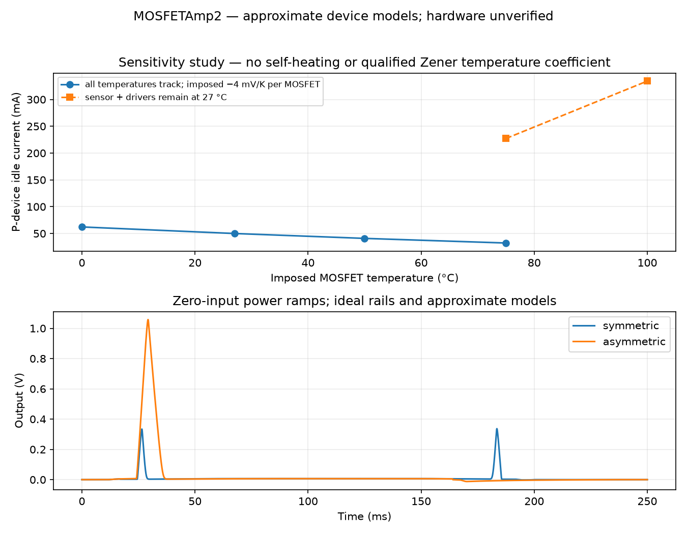

# Simulation results — ngspice 47, Rev 0.1

**All results use explicitly approximate MOSFET, driver and Zener models. These are circuit-development results, not measured amplifier specifications.** The BC546B/BC556B models came from the installed LTspice NXP library, not the actual stocked ST/onsemi devices. Public manufacturer MOSFET model downloads failed (empty responses/404/403). Model provenance and omissions are in `simulation/models/README.md`. The final circuit uses 330 pF compensation and the 1 kΩ/47 kΩ/130 Ω bias divider. No output short-circuit limiter is present.

## Operating points

The nominal model was individually adjusted to 50 mA P-device current at ±15 V: numerical rheostat 37.70 Ω. **Do not use that number as a construction setting.** All rail sweeps below retain that one adjustment.

| Rails | Output DC | Iq N / P | + / − rail current magnitude | Idle input power/channel |
|---|---:|---:|---:|---:|
| ±12 V | 5.54 mV | 40.3 / 39.4 mA | 51.3 / 50.6 mA | 1.22 W |
| ±15 V | 6.54 mV | 51.0 / 50.0 mA | 62.8 / 62.0 mA | 1.87 W |
| ±16 V | 6.85 mV | 54.2 / 53.2 mA | 66.3 / 65.4 mA | 2.11 W |
| ±20.5 V | 8.17 mV | 67.1 / 65.9 mA | 80.3 / 79.2 mA | 3.27 W |

## Sines, gain and distortion

±15 V, 8 Ω, 0.5 V peak external input; fitting the final three cycles to harmonics 1–10. THD here is harmonics 2–10 divided by the fundamental; it is not THD+N. Adaptive transient samples are uniformly resampled and fitted by least squares. A residual column is recorded in JSON to expose fitting/numerical error. The tiny low-frequency figure is strongly model-dependent and must not be advertised as hardware performance.

| Frequency | Fundamental Vpk | Power | Gain | THD 2–10 |
|---|---:|---:|---:|---:|
| 20 Hz | 5.261 V | 1.730 W | 10.521 | 0.00013578% |
| 1000 Hz | 5.261 V | 1.730 W | 10.521 | 0.0049772% |
| 20000 Hz | 5.254 V | 1.725 W | 10.508 | 0.10387% |

AC gain at 1 kHz is 20.441 dB. Relative to that, 20 Hz is +0.00003 dB and 20 kHz -0.0113 dB. DC coupling creates no intentional low-frequency high-pass pole. Nominal maximum simulated output slopes are +5.97/−5.20 V/µs. A 10 V peak/20 kHz sine requires 1.26 V/µs. The slope test is a 1 kHz, 0.7 V peak input square wave; it does not characterize every clipping condition.





## Clipping power and headroom

1 kHz, stiff symmetric rails, 8 Ω. Binary search uses eight iterations over input amplitude; entries are the last sample below the stated THD threshold, not exact clipping boundaries. Power uses the fundamental, Vpk²/16. The 0.1% column is the conservative approximate useful-output estimate; the 1% column includes clipping. Real rails, device spread and temperature can reduce it.

| Rails | Vpk at <0.1% | Power at <0.1% | Power at <1% | Efficiency at <0.1% |
|---|---:|---:|---:|---:|
| ±12 V | 5.68 V | 2.02 W | 2.22 W | 35.1% |
| ±15 V | 8.45 V | 4.47 W | 4.89 W | 42.5% |
| ±16 V | 9.44 V | 5.57 W | 6.03 W | 44.6% |
| ±18 V | 11.29 V | 7.96 W | 8.60 W | 47.7% |
| ±20.5 V | 13.63 V | 11.61 W | 12.47 W | 50.8% |
| ±21 V | 14.12 V | 12.46 W | 13.35 W | 51.4% |

The ±20.5/21 V rows are supply-stress feasibility cases, not continuous stereo output ratings or SOA approval. A real 12-0-12 VAC supply is expected to support a more modest nominal output, depending on ripple valleys and regulation. See `DESIGN.md`.



## Loop and reactive loading

AC voltage injection splits the feedback input between the divider and Q101 base, retaining its DC bias. Return-ratio estimate is `−V(FB)/V(FBI)`. The finite impedances and other feedthrough paths make this an approximate voltage-injection result. It is **not** a complete two-injection/Tian return-ratio proof. The voltage-injection ratio approaches unity again at very high frequencies, where feedthrough and finite injection impedances make its interpretation unreliable; quoting only the first margin cannot certify broadband stability. Fixed MOSFET gate capacitances and approximate BJT bandwidths are further limitations.

| Load | First crossover | Approximate first-crossing phase margin |
|---|---:|---:|
| 8R | 294.1 kHz | 79.2° |
| 4R | 277.5 kHz | 80.7° |
| 8R_10n | 293.7 kHz | 78.6° |
| open_100n | 318.7 kHz | 68.2° |
| reactive | 318.8 kHz | 68.3° |
| reactive + selected parasitics | 329.5 kHz | 66.0° |

`8R_10n` = 8 Ω || 10 nF; `open_100n` = 1 MΩ || 100 nF; `reactive` = (8 Ω + 0.5 mH series) || 100 nF. The selected parasitic case adds 30 nH external gate inductance, 10 nH MOSFET source inductance, 100 nH per wirewound source resistor, 10 nH film-bypass ESL and 0.1 Ω bulk-capacitor ESR. These are chosen estimates, not extracted PCB/component models. A second test doubles lumped Cgs/Cgd under an 8 Ω || 100 nF load. The final output coil is ideal in the base model; its estimated 8–10 mΩ DCR is not included.

The 10 kHz square tests use 0.2 V peak input and 200 ns edges. Saved waveforms show settling under all tested loads. With a nearly open 100 nF load, the external coil/capacitor resonance produces substantial post-coil overshoot; this is not a clean-square-wave claim. The 8 Ω/10 nF case is much better damped. Inspect OUT and SPK separately. The numerical envelope below is taken after 0.6 ms; it does not establish absence of oscillation on a real PCB.

| 10 kHz load | SPK minimum / maximum |
|---|---:|
| 8R | -2.118 / 2.123 V |
| 4R | -2.108 / 2.117 V |
| 8R_10n | -2.120 / 2.124 V |
| open_100n | -3.133 / 3.060 V |
| reactive | -3.125 / 3.073 V |

4 Ω is an analysis comparison only; this revision has no 4 Ω operating rating. Extreme capacitance and parasitic tests do not close the unknown hot-SOA issue. PCB parasitics, real gate charge and full-bandwidth bench square-wave tests remain required.





## Bias, temperature and tolerance

There is no thermal-feedback/self-heating simulation. MOSFET VTO is explicitly shifted by −4 mV/K in magnitude and KP by (T/300.15 K)^−1.5; the MOSFET intrinsic model remains at 27 °C to avoid double counting. Sensor/driver temperatures are separately assigned. Input-pair/reference-device temperatures are nominal in this study. These are sensitivity experiments, not a calibrated electrothermal model. Zener temperature coefficient is unqualified.

| Imposed condition | Iq P |
|---|---:|
| junction0_sensor0_driver0 | 62.2 mA |
| junction27_sensor27_driver27 | 50.0 mA |
| junction50_sensor50_driver50 | 40.9 mA |
| junction75_sensor75_driver75 | 32.3 mA |
| junction100_sensor75_driver75 | 104.1 mA |
| junction75_sensor27_driver27 | 227.2 mA |
| junction100_sensor27_driver27 | 334.3 mA |

At 75 °C with matched sensor/driver temperatures, imposing −2/−4/−6 mV/K per MOSFET gives respectively 0.08 mA, 32.27 mA, 107.81 mA. A further ±150 mV Zener-voltage sensitivity at 75 °C gives 1.7 to 87.9 mA. This is not a guaranteed Zener tolerance/temperature law; it demonstrates why actual device measurements matter.

| Fixed-adjustment corner | Iq P |
|---|---:|
| bias_R_high | 75.6 mA |
| bias_R_low | 28.7 mA |
| input_1mV | 49.4 mA |
| BD_beta_25 | 72.5 mA |
| BD_beta_250 | 45.6 mA |
| rheostat_0 | 628.91 mA |
| rheostat_2000 | 0.03 mA |
| rheostat_1000000000.0 | 0.02 mA |
| vth_-0.5_-0.5 | 718.73 mA |
| vth_-0.5_0.5 | 50.44 mA |
| vth_0.5_-0.5 | 49.93 mA |
| vth_0.5_0.5 | 0.07 mA |

With maximum resistance and VTO=2 V for both device magnitudes, the model gives 48.8 mA. With the same low-threshold pair at 75 °C, including tracked sensor/driver temperatures and the imposed threshold/mobility changes, current rises to 262.5 mA. **This is a failed thermal corner.** The much lower required DC spread reduces the multiplier ratio and its thermal compensation. Per-channel adjustment alone does not fix the slope. Resolve the compensation or characterize/select actual pairs before release. These cases do not cover every temperature/Zener/transconductance combination. An open pot branch reduces nominal spread to about 5.09 V. A shorted trimmer can overbias the pair. Fit the bias-short header for the first power check and follow the current-limited commissioning procedure.



## Startup and overload

- Symmetric ideal rail ramps: output minimum -0.002 V, maximum 0.337 V.
- Asymmetric ideal rail ramps: output minimum -0.012 V, maximum 1.058 V.
- After three clipped 1 kHz cycles followed by 0.1 V peak input, the last-three-cycle fit returns 1.052 V peak output, 6.54 mV DC and 0.0041% model THD.
- With BP–BN shorted and load disconnected, initial ±8/12/15 V models draw approximately 8.3/9.5/10.3 mA per rail and essentially zero MOSFET current. This verifies the intended first-power condition in the nominal models.

Startup sources use explicit PWL ramps with initially discharged capacitors. They omit actual bench-supply current limiting, bridge/reservoir charging, relay action and real semiconductor failure modes. External speaker muting/protection must be verified with the actual PSU.

## Unresolved verification and release gates

1. Obtain usable manufacturer MOSFET/driver models or measured transfer/capacitance data. Repeat AC, transient and mismatch work. Actual hi-fi THD/noise is unmeasured; no noise specification is claimed.
2. Resolve the failed low-threshold/hot corner. Characterize actual low-current VGS and thermal slope, fit the sensors and demonstrate stable cold/warm idle and signal-to-idle recovery. Qualify the Zener thermal behaviour and adjustment range for the owned/purchased parts.
3. Establish hot linear-mode SOA for repetitive low-frequency and intended reactive loads. The published 10 ms pulse curves do not guarantee DC or 20 Hz service. Analytical average thermal margins do not close this item.
4. Measure heatsink/interface performance, supply extremes/ripple and external speaker-protection behaviour. No output-short or 4 Ω rating is implied.
5. Resolve physical pot/resistor/coil fits, lay out the board, inspect current paths and run DRC. Real full-bandwidth oscillation and thermal tests remain mandatory.

## Reproduction and saved evidence

Run from the project root with Python 3.11+ and `numpy scipy matplotlib` installed:

```sh
python3 simulation/run.py
python3 simulation/extended.py
python3 simulation/supplement.py
python3 tools/plot_results.py
python3 tools/report_results.py
```

The ideal zero-ohm trimmer endpoint is internally coerced by ngspice to 1 pΩ. Its first dynamic-gmin attempt fails, then true-gmin stepping converges to the logged operating point. This endpoint warning is retained; no transient timestep failure occurred. The large endpoint current is a warning about the adjustment range, not a precise physical short-contact prediction.

The scripts use the project-local ngspice executable; set `NGSPICE` to another compatible ngspice 47 path if needed. Bundled executable is macOS arm64. The scripts require only local files and do not query or modify inventory. Individual generated decks are in `simulation/results/`; their include paths assume the simulation directory as working directory. `.txt.gz` files are the losslessly compressed numeric traces, readable by NumPy or gzip; a rerun writes fresh uncompressed `.txt`. Logs and the three JSON summaries are retained. Figures are generated from those traces. A source/result checksum manifest accompanies the final evidence.
