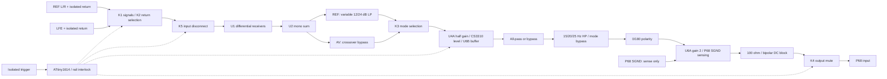

# SubController — final schematic engineering review

**Revision B; reviewed 8–9 October 2026. Schematic corrections implemented. NOT READY TO ORDER A PCB.**

The remaining fabrication gates are identified below. This is an independent electrical/netlist/datasheet review, with numerical response and tolerance calculations. It is not a claim of bench, thermal, firmware, enclosure or PCB qualification. The existing PCB was deliberately left untouched and does not represent these schematic changes.

Primary deliverables: [reviewed schematic PDF](schematic.pdf), [complete BOM and inventory allocation](BOM.md), [purchases/fit checks](PURCHASES.md), [firmware contract](../FIRMWARE-REQUIREMENTS.md), [ERC report](edited-erc.rpt), [calculation results](engineering-calculations.json), [connection/AC assertions](connectivity-and-AC.json). The root `SubController.kicad_sch` and its eight child sheets contain the actual changes.

## PASS — retained from the supplied design

- Separate left/right signal buffering and resistor mono summing; no direct L/R signal connection. U2A and U2B provide inversion then reinversion. The actual summing resistors were 22k, so the original “0.5 each” annotation was inaccurate; the circuit itself was usable.
- Relay selection before active circuitry disconnects inactive sources. Reference remains the unenergised mode. K3 selects raw mono in AV, bypassing the Reference crossover.
- Unity-gain Sallen–Key low-pass sections, selectable one/two sections; the topology and capacitor ratio are correct. Component impedance/range were revised below.
- CS3310 used as an analogue level controller, not as a filter rheostat. Separate saved Reference/AV settings are appropriate. Its digital supply shares its positive analogue rail, avoiding the prohibited digital-before-analogue sequence.
- All-pass topology, 0/180° polarity choice, configurable second-order high-pass and bypasses are electrically valid.
- TPS7A3901 bipolar regulator pin mapping and feedback, including the negative regulator's BUF connection, are correct. Existing input/output capacitor provisions were retained.
- Optical trigger isolation, hardware rail-fault override, normally muted output relay, local supply decoupling, UPDI access and the separate P68 amplifier interface concept were useful foundations.

## CHANGED — implemented in KiCad

| Change | References | Reason |
|---|---|---|
| Differential input receivers with 47k matched ratios and paired 100p C0G compensation | U1, R1–R4, R119–R122, C1/C2/C64/C65 | Shared PSU ground must not hard-bond the selected RCA return to P68 power ground. Input impedance also increases. |
| One contact pole transfers the selected return; Reference L/R returns share an isolated REF_RETURN bus | K2A; K2B unused | Avoids a brief ground bridge caused by different transfer times of two poles. The selected return is sensed through resistors. |
| Panasonic relays throughout, plus an input-disconnection relay | K1–K5 | User-selected AGN2004H, driven from +5R. K5 disconnects powered source signals from unpowered/muted op-amp inputs. Five of six owned relays are required. |
| Exact existing relay footprint/STEP made project-local | `libraries/Custom.pretty`, `InputSwitch.3dshapes`, `fp-lib-table` | Preserves the user's CAD part and makes its existing model path resolve in this project. |
| Lower-impedance crossover with shunted pot tracks | R10/R17/R24/R31=4k27; R115–R118=15k; six LP capacitors=220n | Keeps the 4570 input source resistance below its recommendation; preserves nominal 40–120Hz adjustment and reduces track sensitivity. |
| ATtiny1614 replaces ATtiny412 plus MCP23008 | U8; U9 and redundant parts removed | Enough direct pins, and MCU reset can no longer leave an expander's RUN output latched on. |
| CS input fault-current resistor inside feedback, with local HF compensation | R112=2k2/0.25W, C62=100p | Limits input injection during supply mismatch without imposing a 2k2 normal audio source impedance on CS3310. |
| Hardware CS mute powered from the rail it protects | R97 moved to +5A | Loss of +5R still asserts CS mute while +5A remains present. |
| Negative comparator-input clamps and rescaled dividers | D7 BAT54A; R85/R86/R89/R90 | Bounds negative sense voltage when the reference/control rail disappears ahead of negative rails. R90 is standard 86k6. |
| P68 signal-ground sensing at the output | U6A, R52/R53/R113/R114, J16, K4 | Preserves the P68 10Ω SGND-to-PGND link despite the required shared power supply. |
| Output DC blocking and charging path before the mute contact | C63=10µF bipolar; R55=22k | Prevents a sustained output-stage offset from being applied as a relay-closing step. |
| Revised relay base drive and power budget | R93=100R, R96=4k7; R95 remains 1k | Drives K4/K5 together while retaining fault-current limiting at the MCU output. |
| LP bypass, hard mute and labelled test points | J25/J26, TP7–TP18 | Makes each processing block and control state accessible during commissioning. |

## Final block diagram

GR10 mains remain full-range. The processor has no main-speaker high-pass output, ADC, DAC or DSP.

## Grounding and wiring — shared PSU solution

Use one local **GND** for processor analogue/control circuits, connected by the power harness to the P68 PSU power-star 0V. Keep relay/regulator/digital current paths physically away from input/filter returns on a continuous ground plane. No arbitrary AGND/DGND plane cuts are prescribed.

| Net/domain | Intentional connection |
|---|---|
| REF_RETURN | Reference L/R RCA shells joined to each other only, before K2. Isolated from inactive LFE. |
| LFE_RETURN | Marantz RCA shell, selected by K2 only in AV. |
| SOURCE_RETURN | K2 common; enters U1 receiver resistors. **Never hard-bond to local GND/chassis.** |
| Local GND | Processor power return and control return; one dedicated connection to PSU power star. |
| AMP_RETURN | J16.2 → SubAmp J6.1 SGND, a separate sense conductor. **Never substitute the power-return wire.** |
| AMP_OUT | J16.1 → SubAmp J6.2 signal. K4 shorts this to AMP_RETURN while muted. |
| Protective earth / chassis | PE remains permanently bonded to exposed metal by the system safety arrangement. Never switched or routed through an audio resistor/relay. |

U1 ideally produces `Vsignal − Vsource_return`. Its signal input impedance is about 94k per Reference channel and 47k for duplicated LFE. Four 0.1% resistor ratios give approximately 54dB worst-case low-frequency common-mode rejection before source-impedance/capacitor mismatch; the circuit is a differential receiver, not galvanic isolation. The selected return draws small signal/common-mode currents through its resistor network. The inactive RCA pins have no permanent resistor, clamp or IC path to GND.

U6A ideally produces `VAMP_RETURN − 2 × VPOLARITY_OUT`. R113/R114 present 30k from AMP_RETURN to local GND. In parallel with SubAmp R23=10Ω this is 9.9967Ω, rather than a short. Four 0.1% output ratios limit ideal ground-tracking error to 0.267% (51.5dB); changing output gain resistors individually would spoil this cancellation. C63 and R55 both reference the amplifier return on their output side.

RCA bodies must be insulated from the enclosure. Do not join connector shields to chassis elsewhere, bridge SOURCE_RETURN/AMP_RETURN with mounting holes, or bond them through test equipment. The optocoupler input loop is wholly separate from local GND. Relay coils and MCU reference local GND only; CS analogue/digital ground pins also use that local plane. Regulator ground and heatsink-tab arrangements must not create another chassis bond.

A chassis/audio loop-breaker, if needed by the complete installation, belongs at the single documented audio-power-ground/chassis connection. Do not add another indiscriminately or place one in PE. The enclosure/PSU/other-equipment earth diagram is not supplied, so that external connection is **not signed off** here. Scope/programmer USB grounds can defeat the isolation being measured; use differential/isolated measurement where required. No P68 schematic change was made.

## Filters and integration

### Reference low-pass

For each unity Sallen–Key section:

`H(s) = 1 / [1 + s Cg(Ra+Rb) + s² Ra Rb Cf Cg]`

`f0 = 1/(2π√(Ra Rb Cf Cg))`; `Q = √(Ra Rb Cf Cg)/(Cg(Ra+Rb))`.

Cf=440n (two 220n in parallel), Cg=220n. Each resistance is `4k27 + (pot_track || 15k)`. Equal tracks give Q=0.7071, nominal endpoints **39.84–119.80Hz**. Physical track resistance at 70Hz is approximately 3.81k. Maximum DC source resistance at both tracks' +20% end is about 27k; the original network could exceed 50k.

| Selection | Electrical response at f0 | Asymptotic slope |
|---|---:|---:|
| J4 1–2 | −3.01dB, second-order Butterworth | 12dB/octave |
| J4 2–3 | −6.02dB, two cascaded Butterworth sections | 24dB/octave |

The latter is an electrical LR4 low-pass, but **does not form an acoustic LR4 crossover with full-range GR10s**. Start with 12dB at about 60–70Hz; compare measured acoustic summation against 24dB. Neither slope guarantees a flat in-room total. There is no enclosure equalisation/Linkwitz transform; a sealed driver may need level/placement/crossover adjustment rather than boost.

The 20k pot's ±20% total resistance alone shifts the low end to about **37.89–42.59Hz**, before capacitor tolerance. Its published divider-tracking figure is not a rheostat-matching guarantee. Measure all four tracks at several knob positions before layout, and retain the better owned specimen. Prefer capacitor pair/section matching to 1–2%; 0.1% fixed filter resistors everywhere would not cure a poor pot.

A 50,000-trial independent-uniform calculation with 1% resistors, 5% individual films and matched nominal pot tracks gives 70Hz section f0 5th–95th percentiles **68.02–72.11Hz**, Q **0.687–0.728**. The two-stage attenuation at 70Hz spans approximately −6.61 to −5.43dB over those percentiles. An illustrative additional ±20% track-scaling model broadens section f0 to 66.52–74.06Hz; it is sensitivity analysis, not a guarantee of actual Bourns tracking.

### Subsonic high-pass

`H(s) = s² C1 C2 R1 R2 / [1 + s R1(C1+C2) + s² C1 C2 R1 R2]`.

C1=C2=440n. J11/J12 must select matching rows; never fit mixed settings or leave them open while running.

| Nominal setting | R1 / R2 | Calculated f0 | Q |
|---|---|---:|---:|
| 15Hz | 16k9 / 34k | 15.09Hz | 0.7092 |
| 20Hz | 12k7 / 25k5 | 20.10Hz | 0.7085 |
| 25Hz | 10k2 / 20k5 | 25.01Hz | 0.7088 |

Slope is 12dB/octave. At the 20Hz setting, attenuation is only 0.260dB at 40Hz and 0.015dB at 80Hz, but phase advance is **43.5° at 40Hz**: include it in acoustic integration. The same tolerance model gives HP20 f0 19.61–20.61Hz and Q 0.7036–0.7133 at the 5th–95th percentiles.

The documented Reference starting configuration is 20Hz. J13 lets AV bypass this filter or share it; AV low-pass bypass is unconditional. Choose the AV high-pass deliberately from excursion measurements before high-power use. Bypassing it is not a declaration that the AVR protects the woofer. C63 adds a small output coupling pole, approximately 1.4Hz loaded; it is not the intended subsonic protection.

### Phase and polarity

The first-order all-pass is `H(s)=(1−sRC)/(1+sRC)`, with C=220n and R=2k2+(50k pot||47k). Ideal magnitude is unity. Phase endpoints:

| Frequency | Minimum R | Maximum R |
|---|---:|---:|
| 40Hz | −13.9° | −111.2° |
| 70Hz | −24.0° | −137.3° |
| 120Hz | −40.1° | −154.3° |

J10 supplies true bypass for 0°. J15 adds 180° inversion. This is frequency-dependent phase rotation, not time delay or a constant 0–180° control. Retaining it is useful with full-range mains and a tunable sub low-pass. R40/R41 matching controls amplitude flatness; the allocated 0.1% 10k stock is suitable. Panel wiper is strapped to its unused end for a defined open-wiper fallback. Keep panel wiring short and away from mains/digital edges.

## Gain and headroom

Default R38=20k, CS code192 (0dB), source impedances small, grounds nominally equal. Source design ceiling **4Vrms**; usual setup reference **2Vrms**. A single Reference channel contributes half the correlated L+R result; opposite-phase stereo bass can cancel normally in a mono sum.

| Stage / function | Local gain | REF12 at 70Hz, LP=70Hz | REF24 at 70Hz, LP=70Hz | LFE at 70Hz, HP bypass |
|---|---:|---:|---:|---:|
| RCA input | — | 2.000 each | 2.000 each | 2.000 mono |
| U1 receiver outputs | +1 differential | 2.000 each | 2.000 each | 2.000 duplicated |
| U2A sum, magnitude | −10/22 each | 1.818 | 1.818 | 1.818 |
| U2B mono | −1 | 1.818 | 1.818 | 1.818 |
| Selected crossover output | 0.707 / 0.5 / bypass | 1.286 | 0.909 | 1.818 |
| U4A / CS input | −0.5 | 0.643 | 0.455 | 0.909 |
| Actual U4A output before R112 | 1.44 × CS input, nominal load | 0.926 | 0.655 | 1.309 |
| CS level output | 0…1 | 0.643 | 0.455 | 0.909 |
| U6B buffer | +1 | 0.643 | 0.455 | 0.909 |
| Phase stage/bypass | magnitude1 | 0.643 | 0.455 | 0.909 |
| Selected high-pass output | HP20 / AV bypass | 0.641 | 0.453 | 0.909 |
| Polarity stage | ±1 | 0.641 | 0.453 | 0.909 |
| U6A output, relative to sensed SGND | −2 | 1.282 | 0.906 | 1.818 |
| P68 connector after R54/C63 | frequency-dependent ~0.991 | **1.270** | **0.898** | **1.802** |

All level columns are Vrms. Filter stop-band attenuation is intentional. Overall pass-band gain is approximately **0.901 (−0.90dB)** including the output load, before selected filters and level attenuation.

At 4Vrms input the largest ordinary signal is 5.657V peak at U1; mono is 5.143V peak, CS input/output at unity is 2.571V peak. Allowing the CS minimum 8k input resistance makes U4A's actual output approximately 3.845V peak, still comfortable. At minimum valid CS supply (±4.75V), the available linear output limit is ±3.5V: approximately 2.68dB signal-only margin at the 4Vrms ceiling, reduced by tolerances/DC offsets. Do not use the theoretical ~5.44Vrms clipping boundary as the operating target.

Use ±10V peak as a conservative 4570 output design reference at a 2k load on ±15V, rather than its typical swing. All normal bass-band output currents are well below its 10mA recommendation; the output isolation stage drives about 11.2k in parallel with its feedback path. At the smallest phase resistance, U6B's ultrasonic load approaches 1.8k, but its signal is small and maximum demanded current is under 2mA. Verify that stage with a scope; do not treat the 10V/2k datasheet test as a guarantee for every capacitive network. External capacitive loading is isolated by R54=100Ω. Keep CS output-to-U6B trace capacitance below 100pF.

**P68 interface:** the actual SubAmp netlist has C1=10µF, R1=1k, R2=22k and feedback R12=22k/R9=1k with C4=100µF. Its approximate input impedance is 23k above the input coupling corner. Closed-loop amplifier gain is about23; connector-to-output gain is approximately22 including the input divider. With ±45V rails, the ideal impossible-to-exceed sine sensitivity is 45/(√2×22)=1.45Vrms; allowing output-stage headroom suggests roughly **1.2–1.4Vrms** for clipping. Exact loaded sensitivity must be measured; this review does not certify the P68 at ±45V into 4Ω.

Thus 2Vrms LFE has ample drive. At a Reference cutoff, 24dB selection intentionally gives lower output, so maximum power at that particular frequency is not assured with a 2Vrms source. If the actual preamp level is insufficient, **R38=10k is a supported resistor-only +6dB commissioning option**. Then restrict source input to ≤2Vrms and recalibrate both saved levels. This avoids a PCB change and preserves the precision output ground-sensing ratios. Never enable CS positive-gain codes to solve this.

## Op-amp DC, stability and noise audit

The electrical basis is the [Renesas/NEC µPC4570 datasheet](https://www.renesas.com/en/document/dst/upc4570-datasheet): unity stable, recommended ±4…±16V, common mode ±12V at ±15V, maximum recommended source resistance50k, capacitive load100pF at unity, 5V/µs minimum slew rate. Supply is 5mA typical/8mA maximum per dual, not per channel. Salvaged stock identification remains a user check: inventory's “JRC4570” text is not proof of NEC silicon.

| Op-amp section | DC condition / stability review |
|---|---|
| U1A/B | Matched differential gain1; both input resistances seen by bias currents about23.5k. Approx local offset bound 2Vos+47k·Ios ≈14.7mV with matched resistors; source DC passes. Matched feedback/input capacitors avoid unmatched HF positive feedback. |
| U2A | Inverting sum; non-inverting input at GND, noise gain1.909, finite DC feedback10k. |
| U2B | Inverting unity, noise gain2, finite DC feedback10k. |
| U3A/B | Direct negative feedback. DC gain1; source resistance <=27k. Filter poles <=120Hz, far below op-amp loop crossover; capacitors are reached through resistive paths at high frequency. |
| U4A | DC gain−0.5 at ATT_IN; actual op-amp output supplies both feedback and CS load. C62 gives local HF feedback while R112 limits abnormal input current. |
| U4B | Conventional first-order all-pass, noise gain2, DC input resistance <=26.5k. No amplitude boost intended. |
| U5A | Unity HP stage; input DC bias returns through selected R2<=34k. DC output is offset/bias only; no floating input if both bank shunts fitted. |
| U5B | Conventional inverting unity polarity path, noise gain2. |
| U6B | CS output buffer with direct negative feedback; no unused half. |
| U6A | Differential ground-sensing gain−2, noise gain3; plus-input resistance6k67 matches R52||R53. C63 removes final DC from amplifier connector after settling. |

All twelve sections have defined power and feedback; none is left unused/floating. For a deliberately conservative independent-error superposition (5mV offset and up to400nA at each input), modelled internal DC bounds in Reference/HP20 are: BUF47.6mV, MONO70.8mV, LP12 86.6mV, LP24 102.4mV, CS input62.7mV, post-phase102.9mV, HP15.2mV, output amplifier61.4mV. This overbounds correlated bias currents; it excludes source DC and adds no CS offset. Add up to0.75mV at the CS output before downstream gains. C63's real leakage, rather than the ideal AC model's vanishing DC, determines final residual DC. Measure it.

The illustrative two-pole U4A loop model fits 7MHz unity frequency and50° native phase margin: calculated loop crossing6.95MHz, margin51.4°. Modelled source impedance at the CS pin is about1.7Ω at120Hz and280Ω at20kHz, below the required600Ω. This is a useful compensation check, **not a manufacturer SPICE model or layout-stability proof**. Check every output for RF oscillation under real cable/load conditions. Required 4Vrms/20kHz slew is only0.711V/µs at U1, well below5V/µs; bass-band requirements are much lower.

Estimated integrated processor noise, 20Hz–20kHz, is about12.3µVrms Reference/bypass-phase and14.3µVrms AV/bypass-phase; full all-pass gives13.7/15.5µVrms. These combine resistor noise, a white op-amp model and typical CS noise; 1/f, pot excess/contact noise, hum and digital feedthrough are excluded. They are estimates, not measured SNR or distortion claims.

## Electronic level control and other inventory candidates

[CS3310 datasheet](https://www.mouser.com/datasheet/2/76/CS3310_F1-18400.pdf): ±5V analogue and +5V digital operation; resistor attenuator plus active output amplifier, not a floating potentiometer. This design uses −95.5…0dB in0.5dB steps and mute; positive gain is forbidden. Right input is grounded, right byte zero, unused output/serial-out explicitly NC. Serial order is right then left, MSB first. ZCEN is high; allow25ms after mute writes to cover the18ms timeout. Hardware mute starts calibration; external input DC is not calibrated away. Maximum specified output offset is0.75mV, noise4.2µV typical/8.4µV maximum; quoted THD+N0.001% typical/0.0025% maximum is under its datasheet conditions, not a board result. VA+ and VD+ are physically the same +5A net. Collector logic prevents +5R backfeeding +5A. R112 limits abnormal input current below7.3mA at the stated supply ceiling.

Live inventory search also found NJW1195A (3, SSOP32), LM1971 (2, SOIC8), PGA2311 (3, DIP16), ATtiny412 (6) and MCP23008 (1). None is substituted into the filter: digital volume devices are not generic rheostats. Full electrical qualification of these **unused** alternatives is not claimed or needed for the retained circuit. The four-gang mechanical pot controls frequency.

## Relay logic and power sequencing

[Panasonic GN datasheet](https://mediap.industry.panasonic.eu/assets/download-files/import/ds_61007_en_gn.pdf) pin map: coil1+/8−, NC2/7, COM3/6, NO4/5. AGN2004H is a **4.5V**, approximately145Ω coil. The user explicitly requires5V operation. This exceeds the manufacturer's nominal-voltage recommendation although below its20°C maximum allowable coil voltage; temperature-dependent limits and enclosure heating must be checked. It is not relabelled as a5V relay.

| State | K1–K3 | K4/K5 | Result |
|---|---|---|---|
| Unpowered or MCU reset | Released | Released | Reference selected; source signals disconnected from buffers; P68 input shorted to its SGND. |
| Reference running | Released | Energised | Reference input/LP/selected HP; output connected. |
| AV running | Energised | Energised | LFE input, Reference LP bypass; selected AV HP option. |
| Rail fault / J22 / J26 | Mode may remain | Released | Hardware input disconnect and output short; CS mute asserted. |

No expander retains RUN across reset. [ATtiny1614 pinout](https://ww1.microchip.com/downloads/en/DeviceDoc/ATtiny1614-16-17-DataSheet-DS40002204A.pdf) is checked; PA0/pin10 is UPDI. All remaining GPIO are assigned. C41 bypasses VDD; BOD/watchdog and direct-pin startup sequencing are mandatory firmware requirements.

C63=10µF bipolar has a nominal muted charging time constant0.221s through R55. With +20% capacitance/+1% resistance it is0.268s; two seconds leaves <0.058% of an initial step. K4/K5 share RUN, so keep CS gain0 for a further two seconds after connecting inputs before ramping volume. The [Nichicon UES1H100MPM](https://www.nichicon.com/en-us/part/ues1h100mpm/5422/) is8mm diameter,11.5mm tall,3.5mm pitch. Its custom footprint removes polarised-capacitor markings; it has no fabricated 3D model.

Q4 nominally sinks~100mA; Q5~67mA, with conservative cold-coil allowances120/80mA. Q4 base current is roughly8–9mA; Q5 about3–4mA. Q6/Q7 and Q8/Q9 switch sub-mA control loads except Q9's <=5.25mA clamp current through R95. Verify Q4/Q5 saturation <=0.3V with the actual stock; at that voltage their collector losses are only~36/24mW worst. Coil diode polarity is correct; diode currents are below the1N4148W pulse capability. Diode suppression lengthens release and therefore must be measured. BC337's C/B/E mapping is conventional [manufacturer data](https://www.onsemi.com/pdf/datasheet/bc337-d.pdf); the stock manufacturer is not recorded, so physical transistor checking is retained.

The12V trigger draws about4.9mA; R63 dissipates~53mW, suitable for the0.125W part at nominal12V. Reverse LED voltage is clamped by D1. Do not feed24V without changing R63. The [VO617A-3](https://www.vishay.com/docs/83430/vo617a.pdf) interface only needs to sink the10k logic pull-up. Trigger inactive/open selects Reference; active selects AV. This isolated trigger is not a mains interface.

## Rails, dissipation and asymmetrical shutdown

Input must be **regulated ±15V**, preferably within±2% in normal operation, never beyond±15.75V, sharing P68 power0V. **Do not connect ±45V to J21.** Required supply rating: at least **+350mA / −100mA**. This board does not generate ±15V from the amplifier rails.

| Mode | +15 current typical / budget | −15 current typical / budget | Board dissipation typical / budget | U13 heat typical / budget |
|---|---:|---:|---:|---:|
| Reference running, 2 coils |130 /190mA |38 /68mA |2.52 /4.07W |0.92 /1.34W |
| AV running, 5 coils |230 /311mA |38 /68mA |4.02 /5.97W |1.93 /2.67W |

Budgets include maximum quiescent current, cold low-resistance coils, control allowances and signal-load margin; they are not measurements. Each4570 dual dissipates about150mW typical/240mW maximum at±15V before signal loading. Keep local board ambient <=50°C. U13 needs a heatsink giving **effective junction-to-ambient <=20°C/W** including interfaces; a bare TO-220 is inadequate. Its ground tab must not accidentally add a chassis bond. Standard7805 input/ground/output pinning was checked against [Diodes AS78xx data](https://www.diodes.com/datasheet/download/AS7805A.pdf); the exact stock suffix remains a markings check.

U11 [TPS7A3901](https://www.ti.com/lit/ds/symlink/tps7a39.pdf) produces approximately+4.990/−4.998V. Budget0.35W and solder its exposed pad to GND copper with thermal vias. C46/C57 and C48/C58 give two10µF50V input ceramics per rail; C47/C49 are output10µF ceramics. Effective capacitance under DC bias is relevant, not just printed capacitance. NR/SS, feed-forward and local CS bypasses remain as drawn. D2/D3/D4 provide reverse-discharge paths; electrolytic polarities were checked.

Generating these rails with linear regulators directly from±45V would dissipate approximately30×(0.311+0.068)=**11.4W externally** at the conservative AV budget. A shared-return auxiliary winding or suitable pre-regulation is preferable; the actual external PSU and early-warning timing still need definition.

LM4040A25 shunt current is about3.39mA nominal, conservatively2.98–4.09mA; reference dissipation~8.5mW, R74 worst~11.3mW. No zener is being relied upon near its knee. Its pin1 cathode/pin2 anode/pin3 NC are correct [TI reference data](https://www.ti.com/lit/ds/symlink/lm4040.pdf).

The four [LM339](https://www.ti.com/lit/ds/symlink/lm339.pdf) outputs are wired open collector to RAIL_GOOD. Positive comparator input levels remain within common mode while +5R is valid. Negative thresholds use a lifted reference; D7 [BAT54A](https://www.diodes.com/assets/Datasheets/ds11005.pdf) clamps negative inputs if that reference disappears, with <0.1mA clamp current. The25°C240mV diode limit applies at that current; verify behaviour across the intended temperature range.

| Rail | Nominal collapse threshold magnitude | Conservative25°C tolerance/error envelope |
|---|---:|---:|
| +15 |13.75V |13.40–14.14V |
| −15 |13.75V |13.20–13.92V |
| +5A |4.25V |4.16–4.35V |
| −5A |4.1625V |3.91–4.23V |

Bounds include reference/resistor tolerance, comparator offset/bias and a conservative diode leakage allowance. They are not full-temperature guarantees. The±5V monitors detect **collapse**, not compliance with theCS4.75V minimum. No hysteresis was added: firmware must clear RUN on any fault and require500ms continuously good before starting the full settling sequence. Fast dropout and comparator chatter are muted states, never permission to rearm immediately.

J22 must provide an early warning before analogue rails fall out of valid operation. Mechanical release, CS mute timeout, rail asymmetry and P68 power-stage shutdown cannot be proven from a static schematic. Sudden rail shorts with no hold-up are not guaranteed pop-free. The separate amplifier's speaker-protection relay remains necessary. Test processor-first/amplifier-first power sequences before connecting the woofer.

## Footprints, connectors and testability

Every fitted symbol's pin-number set was compared with its assigned footprint, including explicit no-connect pads. Datasheet pin maps were separately checked for the devices actually used; pad-set equality alone is not package qualification. TPS DSC0010J and Bourns PTD904 use project-local patterns. All five relays use exact copies of the user's footprint/model; model and footprint hashes match the originals. The Panasonic bottom-view drawing was reconciled with KiCad top-view pad positions.

User requested manual verification of salvaged4570 and CS packages. The schematic still assumes NEC µPC4570G2 SOP8 and CS3310 wide SOIC16. Verify actual body/lead dimensions before layout. Loose film stock gives body dimensions but no precise series/lead-form code; verify5mm pitch. New220n film can use [KEMET82DC3220AA60J/R82DC3220AA60J](https://content.kemet.com/datasheets/KEM_F3101_R82.pdf),7.2×2.5mm,63V,5mm pitch. This is polyester film; no X7R/X5R frequency-setting capacitor was introduced.

| Access / control | Function |
|---|---|
| TP1/TP2; TP3/TP4; TP5; TP7 | ±15V, ±5A, +5R, local GND |
| TP8/TP9 | Selected input buffers; Reference L/R or duplicated LFE; K5 must be running |
| TP10/TP11/TP12/TP13/TP14 | Mono, selected LP output, phase output, HP output, final amplifier signal |
| TP6/TP15/TP16/TP17/TP18 | RUN_HW, trigger, AV_ENABLE, RUN_REQUEST, RAIL_GOOD |
| J25 |1–2 LP active;2–3 bench bypass |
| J10 |1–2 phase bypass;2–3 all-pass |
| J11/J12 |Matching15/20/25Hz rows only |
| J13 |1–2 AV HP bypass;2–3 AV HP active |
| J14 |1–2 common HP bypass;2–3 mode-controlled HP |
| J15 |1–2 normal polarity;2–3 inverted |
| J24 |1–2 automatic;open Reference;2–3 AV |
| J26 |Fit shunt to force hardware mute |

J16 pin1 is signal, pin2 is SGND sense. J21 pins1/2/3 are+15/GND/−15. J17 pins1/2/3 areUPDI/+5R/GND. Encoders useA/commonGND/B. J20 pins1/2 aretrigger+/trigger−. J23 isLED anode/cathode; its resistor is fitted. Retained JST-XH connectors require matching2.50mm housings, not the superficially similar2.54mm stock. No mount-hole/chassis copper or board-routing verification was performed.

## WATCH DURING COMMISSIONING — no PCB change expected

- Measure pot tracks, filter-cap matching and actual cutoff scale; trim the four4k27/shunt values if needed. Compare12/24dB acoustic summation with the GR10s full-range.
- Select15/20/25Hz protection against measured sealed-box excursion. Choose AV HP explicitly. There is no limiter or driver-specific excursion model.
- Set polarity/all-pass with acoustic measurements, then calibrate independent Reference/AV levels. R38 permits the documented resistor-only gain change.
- Measure DC at every stage, CS level-step noise, C63 leakage/settling, op-amp oscillation, output cable loading and common-mode rejection.
- Check Q4/Q5 saturation, five-coil5V heating, U13 heatsink temperature and actual±15 current. Enclosure ambient and supply tolerances matter.
- Validate all reset/mute/fault/trigger/EEPROM sequences against the firmware contract, including supply removal while sources continue playing.

## OUTSTANDING RISK — close before fabrication approval

1. **PCB and mechanics are not reviewed or updated.** The existing PCB is stale relative to revision B. Layout, ground-current paths, local decoupling, heatsink clearance, pot fit, connector fit and DRC remain fabrication gates. No layout work was started.
2. **Actual salvaged identities/packages remain unverified**, as the user elected to check them manually. A different4570 package/pinout or narrow CS package could require a footprint change before ordering.
3. **Power-fail timing and firmware are not qualified.** An external early-warning signal and sufficient rail hold-up must be demonstrated with P68's speaker protection. If the actual PSU cannot provide that timing, protection changes may be required; a clean ERC cannot eliminate this risk.
4. **Four-gang rheostat tracking is unmeasured.** A bad mechanical pot may need replacement or a different control approach; resistor trimming cannot correct arbitrary tracking error over travel. Measure it before committing its mechanical footprint.
5. **5V operation of nominal4.5V AGN2004H is an explicit user choice.** Confirm hot-coil operation and temperature margin. The exact footprint is preserved; no assertion that coil overdrive is ideal is made.
6. **The complete chassis/PE/PSU wiring is absent.** The schematic avoids hard source/P68-signal-ground bonds, but other connected equipment can still establish loops. Confirm the system earth diagram and mounting arrangement before manufacture.

These are genuine limits on “first board works”, not requests for another blanket permission. Value tuning is expected; fabrication sign-off is withheld until the above physical/system prerequisites are resolved.

## ERC and independent validation result

**KiCad ERC: 0 errors, 0 warnings.** No new no-ERC markers or error exclusions were added. Pre-existing project-wide ignored categories remain: singleton global labels, four-way junctions, SPICE model issues and footprint-filter mismatch. These existing settings are explicitly disclosed; they are not evidence of correctness.

**549 independent assertions** cover device/relay supply and contact pins, inactive-source isolation, trigger isolation, regulator feedback, diode/electrolytic polarity, unused pins, source/output ground sensing, footprint pad sets and control mapping. **1,740 ideal netlist AC scenarios** exercise source modes, filter settings, unequal pot tracks, phase, polarity and attenuation; maximum complex response error against independent equations is about1.1×10⁻¹³. Additional checks cover CS minimum8k loading and ±1V source/amp-return disturbances. Fifty-thousand-trial tolerance calculations, DC superposition and a limited U4A loop model supplement ERC. No transistor-level whole-board SPICE or hardware measurements were performed.

All nine schematic sheets were exported and visually re-read after editing. `.kicad_pcb`, `.kicad_pro` and `.kicad_prl` are byte-identical to the starting backup. SubAmp was only read/exported. Source backups and SHA-256 records are in this folder. The complete226-reference BOM allocates159 physical components from confirmed inventory without changing reservations; it identifies a shortage of three220n film capacitors plus the new precision/utility values, bipolar capacitor, BAT54A, VO617A-3 and LM4040. See the full parts list rather than purchasing from superseded CSVs.
