# SubController Rev A — schematic review, 7 October 2026

The analogue controller schematic is complete as a review revision. **This update changes the schematic only; the existing user-managed PCB is preserved.** The separate P68 amplifier has not been redesigned. Electrical connections, ideal filter responses and ERC have been checked; this is **not fabrication approval, firmware qualification or bench validation**.

Open `SubController.kicad_sch` through `SubController.kicad_pro` in KiCad. The nine-page rendered schematic is [SubController-review.pdf](render/SubController-review.pdf). Supporting artifacts include [PTD904 footprint review](PTD904-footprint-review.pdf), [block-diagram.pdf](block-diagram.pdf), [response-plots.pdf](response-plots.pdf), [BOM.csv](BOM.csv), [PURCHASES.csv](PURCHASES.csv), [firmware requirements](FIRMWARE-REQUIREMENTS.md), [ERC](checks/ERC.rpt), [connectivity/AC checks](checks/connectivity-and-AC.json), and [noise estimates](checks/noise-estimates.json).

## Signal flow and topology

```mermaid
flowchart LR
 REF[REF L / R RCA] --> SEL[K1 signals / K2 returns]
 AV[Marantz LFE RCA] --> SEL
 SEL --> BUF[U1 buffers]
 BUF --> SUM[U2 averaging mono sum]
 SUM --> LP[U3 selectable REF low-pass]
 SUM --> BYP[AV low-pass bypass]
 LP --> MODE[K3 mode selection]
 BYP --> MODE
 MODE --> PRE[U4A gain -0.5]
 PRE --> VOL[CS3310 analogue attenuator]
 VOL --> VB[U6B buffer]
 VB --> AP[U4B all-pass or bypass]
 AP --> HP[U5A HP / AV bypass]
 HP --> POL[U5B 0 / 180 polarity]
 POL --> OUT[U6A gain -2 / 100R]
 OUT --> MUTE[K4 output mute]
 MUTE --> AMP[Separate P68 amplifier]
```

All audio remains continuous analogue. The MCU controls contacts and analogue attenuation; it never receives the audio. There is no ADC, DAC, DSP, sample-rate conversion or digital crossover. Main GR10 speakers remain full range.

| Section | Implementation | Nominal signal gain |
|---|---|---:|
| Input | Selected-source 1k series, 47k bias, 100p C0G RF shunt; U1 followers | 47/48 = 0.9792 |
| Mono | U2A: two existing 22k inputs, 10k feedback; U2B unity inverter | +(10/22)(L+R) |
| REF LP | U3A/B unity Sallen-Key, Q=0.7071 | 1 in its passband |
| AV | LFE duplicated into both buffers; K3 bypasses REF LP | 20/22 through mono summer |
| Prescale | U4A inverting, 20k input / 10k feedback | -0.5 |
| Level | U7 left channel, attenuation-only firmware | 0 to 1 |
| Volume buffer | U6B follower; limits CS3310 direct capacitive load | 1 |
| Phase | U4B first-order all-pass or bypass | magnitude 1 |
| Protection | U5A unity Sallen-Key HP or bypass | 1 above HP corner |
| Polarity | Direct or U5B unity inverter | +1 / -1 |
| Output | U6A inverting, 10k input / 20k feedback; 100R isolation | -2 |

Two intentional inversions restore positive overall polarity in the 0-degree setting. Maximum AV gain, including input division and 22k P68 load in parallel with the board's 100k output pull-down, is **0.8852, about -1.06 dB**. REF has the same nominal gain multiplied by its LP/HP responses. One active REF channel produces half the output of equal correlated L/R inputs. CS3310 gain settings above unity are prohibited. The live input sheet already used R5/R6=22k before this supply/opto update; this is preserved and included in the recalculated gain/noise, rather than restoring the earlier 20k values.

Each REF input loads its preamp by approximately **48k**. AV duplicates the same LFE source into two identical inputs, giving approximately **24k** LFE loading. A 100-ohm source adds only a small loading loss. Verify the existing reference preamp's actual output stage if its source impedance is unusually high. L and R are never directly joined.

## Reference crossover and PCB-mounted continuous control

The four frequency banks are replaced by **RV1, one owned Bourns PTD904-2015K-B203**, mounted on the eventual PCB. One shaft adjusts all four 20k linear gangs. R10/R17/R24/R31 are now 9k31 series resistors; the other 24 bank resistors and J5-J8 are removed. Existing references outside this crossover control are preserved.

Unity Sallen-Key retains the existing equal nominal resistances, feedback capacitance 200n (two owned 100n films in parallel), and grounded capacitance 100n film:

`HLP(s) = 1 / [1 + s·Cg·(R1+R2) + s²·R1·R2·Cf·Cg]`

For matched gangs, `R = 9k31 + Rpot`, `f0 = 1,125,395.4 / R` Hz, and `Q = sqrt(Cf/Cg)/2 = 0.7071`.

| Calibration target | Total R per path | Pot resistance per gang |
|---:|---:|---:|
| 40 Hz | 28.135k | 18.825k |
| 50 Hz | 22.508k | 13.198k |
| 60 Hz | 18.757k | 9.447k |
| 70 Hz | 16.077k | 6.767k |
| 80 Hz | 14.067k | 4.757k |
| 100 Hz | 11.254k | 1.944k |
| 120 Hz | 9.378k | 68.3 ohms |

Nominal end stops are **38.396-120.880 Hz**. Clockwise decreases rheostat resistance and increases frequency. These table entries are calibration examples, not discrete selections or guaranteed shaft angles. B taper is linear resistance; frequency is reciprocal resistance. All four gangs act together in both slope settings.

J4 retains one Butterworth section, **12 dB/octave and -3.01 dB at f0**, or two sections, **24 dB/octave and -6.02 dB at f0**. The latter is an electrical LR4 low-pass when the sections match. It does not establish a complementary acoustic Linkwitz-Riley crossover with full-range GR10s. Start with approximately 60-70 Hz, 12 dB/octave, HP20 and phase bypass; use REW measurements of mains alone, sub alone and their sum.

Each gang uses its terminal 3 (CW end) through the series resistor, with terminal 1 (CCW end) tied to wiper 2 at the output node. Loss of wiper contact therefore leaves the full track resistance, provided the end-terminal connections remain intact. The four 9k31 resistors bound minimum resistance. Matching total resistances controls both section frequency and Q. For unequal R1/R2, `Q = sqrt(R1·R2·Cf·Cg) / [Cg·(R1+R2)]`.

[Bourns PTD90 rev04/24](https://www.bourns.com/docs/product-datasheets/ptd90.pdf) specifies +/-20% total resistance for this order code, and +/-3dB tracking in a voltage-divider test. That does not guarantee matched filter rheostats. The user will measure both pots and select the better-matched specimen. With identical 16k or 24k end-to-end gangs, the low-frequency end stop would be approximately **44.464 or 33.786 Hz** respectively, before capacitor/fixed-resistor tolerance. 40 Hz coverage is therefore conditional on actual measurements. Series-resistor adjustments can improve one calibration point; they cannot correct arbitrary tracking differences throughout travel.

Owned 5% films still require measuring/matching, particularly their 2:1 ratio. A 20,000-case capacitor/1% series-resistor analysis with nominal matched pots at 70Hz gives a 5th-95th percentile f0 range **68.02-72.11 Hz**, Q **0.687-0.728**. This excludes pot tracking/tolerance and is not a full production tolerance prediction. Ideal nodal checks include both end stops and deliberately unequal gang examples. Pot excess/contact noise is not captured by white resistor-noise estimates; measure sweep noise and LF distortion before qualification. Change frequency muted until adjustment noise has been assessed.

A project-local four-unit symbol and **PTD904_2015K_B203_Horizontal** footprint preserve manufacturer section/terminal identities as pad names R1.1 through R4.3. In top/component view, R1 is nearest the +X shaft. Gang columns are X=-5/-7.5/-12.5/-15mm from the mounting surface, with terminal1/2/3 at Y=+2.5/0/-2.5mm. The pattern has twelve 1.0mm plated holes; copper pads are 1.8mm. The shaft is 6mm knurled, L=15mm, M7x0.75 bushing, B=5mm. Body, front lip, shaft and full mechanical courtyard are drawn. No extra mounting holes appear in the manufacturer's pattern. See [footprint review and actual-size template](PTD904-footprint-review.pdf) and [machine-readable footprint check](checks/PTD904-footprint.json).

This verifies the drawing/pin mapping, not a physical sample fit. Print template page2 at 100%, verify its 20mm scale bar and compare a real pot before fabrication. Its operating temperature is -10 to +50C; the control location must remain <=50C, including amplifier heat. Future PCB placement must align its shaft with the plate, and the nut/washer provide mechanical support. This schematic update does not change PCB placement or routing.

## Phase and configurable subsonic protection

All-pass: `HAP(s)=(1-sRC)/(1+sRC)`, C=220n film, R=2k2 plus a 50k linear panel pot in parallel with 47k. Magnitude remains unity in the ideal model. At 70 Hz, the pot covers approximately **-24 to -137 degrees**; bypass gives zero additional phase. The polarity selector adds 180 degrees. This is frequency-dependent phase, not broadband delay.

The 47k shunt keeps the op-amp source resistance below 50k even if the panel pot is disconnected. Tie wiper to its far end as shown. A stock 50k multiturn can serve the prototype; use a suitable panel pot for the plate. The phase setting is common to both modes, so any AV change must be accounted for in AVR distance/calibration. All-pass bypass is the initial AV setting.

HP: C1=C2=440n, each two owned 220n films; R1 connects the intermediate node to the follower output, R2 connects the second node to GND:

`HHP(s)=s²·C1·C2·R1·R2 / [1+s·R1·(C1+C2)+s²·C1·C2·R1·R2]`.

| Marking | R1 / R2 | f0 | Q |
|---:|---|---:|---:|
| 15 Hz | 16k9 / 34k | 15.090 Hz | 0.7092 |
| 20 Hz | 12k7 / 25k5 | 20.100 Hz | 0.7085 |
| 25 Hz | 10k2 / 20k5 | 25.014 Hz | 0.7088 |

This is approximately Butterworth, 12 dB/octave below the corner. HP20 contributes -0.260 dB / +43.5 degrees at 40 Hz and -0.015 dB at 80 Hz. Its phase must be included during integration.

J11/J12 select the same HP row. J14 bypasses protection completely or uses mode configuration. J13 sets AV HP bypass/filter; K3's second pole selects the configured AV response. **Default REF uses HP20; AV bypasses it.** Thus AV introduces no deliberate LF crossover shaping. Protection is configurable rather than tied to the SB26SFCL38-4. A high-pass is not an excursion limiter; its setting depends on final driver/enclosure, gain and maximum programme level.

| Default assembly setting | Shunt |
|---|---|
| LP approximately 70 Hz | Calibrate RV1; each rheostat approximately 6k77 |
| Slope 12 dB/octave | J4 pins1-2 |
| Phase bypass | J10 pins1-2 |
| HP20 | J11/J12 pins3-4 |
| AV HP bypass | J13 pins1-2 |
| Common HP follows mode | J14 pins2-3 |
| Normal polarity | J15 pins1-2 |
| Automatic source selection | J24 pins1-2 |

## Electronic attenuation decision

Inventory was searched by function and browsed by category: audio volume/attenuation, potentiometers/rheostats, op-amps, relays, controllers/expanders, regulators, capacitors, resistor packages and isolation. The connected inventory snapshot and exact selected-part reads are retained under `source-data/`. A failed/no-result text search is not proof that a physical part is absent. Inventory metadata such as LM1971's “15V” and the “JRC 4570 SOIC” label were not accepted as electrical/package limits.

| Candidate and owned quantity | Supplies / signal range | Topology and control | Performance / startup / LF suitability | Decision |
|---|---|---|---|---|
| CS3310, 5 SMD | ±5 V analogue, +5 V digital; ±3.75 V signal at nominal rails | Two active-buffered channels, 8k minimum input, source <=600R; three-wire 16-bit | 0.5 dB, -95.5 to +31.5 plus mute; 4.2 typ/8.4 max µVrms; THD+N 0.001 typ/0.0025% max at 2 Vrms/1kHz; power-on mute, >=2ms mute calibration; LF response plotted down to 10Hz | Use one channel for level only; per-mode settings in MCU |
| LM1971, 2 SOIC-8 | 4.5–12 V single supply, midpoint analogue reference; keep signal between rails | Mono ladder; 20–60k input, high/variable output resistance; three-wire address+attenuation | 1dB, 0 to -62 plus mute; 4µV A-weighted at -12dB; THD 0.0008% typ at 0.5Vpeak; power-up mute; 20Hz–100kHz ±0.1dB | Requires very low-bias buffer and single-supply/reference or logic translation; not a useful filter rheostat |
| NJW1195A, 3 SSOP-32 | ±3.5–7.5 V; output 3.6 Vrms minimum at ±7V/1%THD | Four volume paths, stereo 4-in/2-out selectors; active outputs, 12k minimum input; three-wire latch | 0.5dB, -95 to +31.5 plus mute; 1.26µVrms typ A-weighted at unity; unbalanced THD 0.001% typ at 2Vrms/1kHz; differential 0.0003%; default mute, LF plots to 10Hz | Useful for level, but extra selectors/reference and noise-rejection capacitors are unnecessary here |
| PGA2311, 3 DIP-16 | ±5 V analogue/+5V digital; ±3.75V signal | Two buffered analogue channels, three-wire serial | 0.5dB attenuation/gain, startup mute; analogue LF-capable | Viable stocked alternative, but DIP loses the SMD preference; not fitted |

Datasheets: [Cirrus CS3310](https://www.mouser.com/datasheet/2/76/CS3310_F1-18400.pdf), [TI LM1971](https://www.ti.com/lit/ds/symlink/lm1971.pdf), [Nisshinbo NJW1195A](https://datasheet.octopart.com/NJW1195AV-TE1-Nisshinbo-Micro-Devices-Inc.-datasheet-180921332.pdf), [TI PGA2311](https://www.ti.com/lit/ds/symlink/pga2311.pdf).

The CS3310 right input is grounded and its right gain byte always zero. VD+ is tied directly to VA+ to meet its power-order requirement. Three collector interfaces reference serial signals to +5A and prevent +5R backfeeding its digital pins. U6B keeps direct CS output trace/input capacitance below its 100pF limit. No analogue signal is applied to a digital-pot resistance terminal.

## Headroom, noise, DC and P68 interface

Design source limit: **4 Vrms** per RCA, equal correlated REF channels or LFE. Buffer maximum is about 5.66 Vpeak; after prescaling, CS input is at most about **2.52 Vpeak**. Its guaranteed signal window at minimum ±4.75 V supplies is ±3.50 V, leaving approximately 2.9 dB margin. The 4 Vrms design limit also allows component tolerances. At ordinary 2 Vrms input, CS input is about 0.89 Vrms; maximum output is about 1.77 Vrms before filter attenuation.

[Renesas μPC4570](https://www.renesas.com/en/document/dst/upc4570-datasheet) permits recommended ±4 to ±16 V, with conventional dual pinout. At ±15 V its specified common-mode range is at least ±12 V and output swing at least ±10 V into 2k / ±12 V into 10k. This design's signals remain well inside those limits. Unity followers are permitted. Minimum slew rate 5 V/µs comfortably exceeds the roughly 0.71 V/µs required by 4 Vrms at 20kHz. Bias-current and source-resistance limits informed the 47k input/phase choices. Salvaged devices need screening rather than assuming their original performance.

Estimated output noise at unity level, 20Hz–20kHz: **11.3µVrms REF with phase bypass; 12.8µVrms REF with phase; 12.0/13.4µVrms AV**. Using the CS maximum noise with other typical parameters gives about 18.4–19.8µVrms. This is an ideal linear/white-noise calculation, not a guaranteed maximum: it excludes 1/f noise, hum, source noise, clock feedthrough and layout effects. The typical estimate corresponds to approximately 103–105 dB below a 2 Vrms output. Total THD is not established by ideal AC calculations and requires measurement, especially at 20–100 Hz.

No unnecessary interstage coupling capacitors are fitted. The HP blocks upstream DC in REF but its follower and output stages still contribute offsets; AV bypass retains DC throughout. Datasheet maximum offsets can accumulate to tens of millivolts or more. Measure AMP_DRIVE DC, select healthy low-offset salvaged parts, and verify muted-to-run transients before connecting the speaker. The output relay is a startup/source-switch aid, not DC speaker protection. Confirm the P68-derived amplifier retains its input coupling capacitor and its separate speaker protection; a DC-coupled variant changes the interface requirements.

[ESP Project 68](https://sound-au.com/project68.htm) specifies nominal 22k input, gain about 23, approximately 1.3 Vrms sensitivity at ±56 V or 2 Vrms at ±70 V. It also discusses the input coupling value. These are the published design's figures: **your actual derivative's input impedance, gain, coupling capacitor and chosen rails have not been supplied/verified**. Controller headroom exceeds typical P68 sensitivity, so calibration attenuation is required; it cannot substitute for an amplifier limiter. At 2 Vrms source, -6dB yields about 0.89 Vrms output before filters.

## Inventory allocation and purchases

No inventory quantities or reservations were changed. 157 individual PCB components are allocated to verified inventory records, plus one PTD904 pot confirmed directly by the user (one of two available); remaining header allocations are provisional and new items are separately listed. Exact references, quantities, package assignments and confidence notes are in the BOM.

| Main owned part | Used / available | Inventory ID | Location / qualification |
|---|---:|---:|---|
| PTD904-2015K-B203 | 1 / 2 | User confirmed | Newly found collection stock; gang matching pending |
| μPC4570G2 | 6 / 22 | 615 | SMD Parts; exact marking confirmed by you; correct NEC G2 SOP footprint |
| CS3310 | 1 / 5 | 595 | Location not recorded; SMD only recorded, confirm KS suffix / wide SOIC body |
| G6K-2P-Y 5V | 2 / 4 | 420 | K3/K4; location not recorded |
| Panasonic AGN2004H | 2 / 6 | 616 | Existing user-selected K1/K2 and custom footprints preserved; not requalified by this scoped update |
| ATtiny412 | 1 / 6 | 80 | SMD Parts |
| MCP23008-E/SS | 1 / 1 | 342 | SMD Parts |
| LM339 SOIC-14 | 1 / 2 | 588 | SMD Parts; verify manufacturer marking |
| BC337 | 9 / 19 | 461 | Location/manufacturer not recorded; verify C/B/E physical order |
| Diodes 7805 | 1 / 17 | 109 | U13 control supply retained; Voltage Regulator drawer; confirm marking |
| TPS7A3901 | 1 / 2 | 500 | SMD Parts; WSON-10 DSC0010J, EP grounded |
| 10k thin-film, 0.1%, 2012 metric | 5 new / 50 | 375 | SMD Parts; total board allocation36 |
| 22k thin-film, 0.5%, 2012 metric | 2 new / 50 | 511 | SMD Parts; total4 including existing R5/R6 |
| Samsung CL31A106KBHNNNE | 6 / 10 | 505 | SMD Parts; 10uF50V X5R,3216 metric; supply bypass only |
| Walsin 10n C0G,50V,2012 metric | 2 / 38 | 88 | SMD Parts; regulator feed-forward C60/C61 |
| 100n film | 6 / 92 | 406 | Parts Drawer2, 5%63V, approximately7x2mm |
| 220n film | 5 / 8 | 414 | Parts Drawer2, 5%63V |
| 100n 50V ceramic, 3216 | 20 / 129 | 157 | SMD Parts; supply/reset bypass only |
| 1µF 50V ceramic, 3216 | 16 / 50 | 181 | SMD Parts; local supply bulk only |
| 47µF 25V Panasonic FR | 3 / 50 | 95 | Parts drawer2; H lead formation is 2.50mm pitch |
| 1N4148W | 3 / 85 | 510 | SMD Parts |
| 1N4007 | 3 / 62 | 124 | Regulator discharge protection |

Resistors remain **2012 metric**. Owned suitable parts are preferentially reused. Four new 9k31 1% thin-film resistors replace all seven-frequency bank networks. The four stock 11k3 resistors are released from this design. The previous six sets of four LP resistors, frequency-bank headers and proposed rotary selector are no longer needed. Other purchases include the HP selections and two20k. The simplified rail detector needs one each of 24k, 43k and 120k at 1%; its other sense resistors use owned tighter-tolerance 10k/100k stock. R75/R76 reuse owned 10k 0.1% parts for the shared reference. No 9k09, 6k2, 93k1, 18k, 7k15 or 30k detector resistors are required.

New active parts: **one user-selected VO617A-3 DIP-4 optocoupler and one LM4040A25IDBZR reference**. New panel/assembly parts: insulated RCA sockets, two encoders, 50k linear phase pot, status LED, shunts, HP-selector headers, heat-sink hardware and optional switches. Two100p C0G input capacitors are specified for purchase. Supply ceramics use owned3216 parts; important filter capacitors use films in the preferred body size.

J1/J2/J3 already have user-selected JST-XH2.50mm footprints, preserved here. Check their matching connectors/housings. For the other generic headers, owned MC34629/MC34631 headers and corresponding Multicomp housings are suitable electrical candidates: [drawing](https://www.farnell.com/datasheets/1751313.pdf) confirms **2.54mm**, not JST-XH2.50mm. Current schematic generic header footprints are **provisional** for these shrouded parts; verify body/courtyard and assign exact footprints before layout. Jumper selectors require ordinary unshrouded headers. Do not assume housing interchangeability.

## Power, control and grounding

Input is externally regulated **±15 V**, preferably within ±2%, absolute design maximum ±15.75 V. Rate the source at least250mA positive/100mA negative. Raw auxiliary regulation and transformer selection are outside this board revision; never connect it directly to high P68 rails. No mains appears on this PCB.

U11 is now the owned **TPS7A3901**, replacing the separate +5A7805 and -5A7905. U13 separately retains the owned [Diodes AS7805A](https://www.diodes.com/datasheet/download/AS7805A.pdf) for +5R control/relay power. The CS3310 and its analogue attenuator function are retained. Its VD+ remains tied to VA+, and the collector control interfaces, rail supervision and output mute remain in place.

Following the [TI TPS7A39 datasheet](https://www.ti.com/lit/ds/symlink/tps7a39.pdf), the positive upper divider uses R10522k0.5% + R10610k0.1%, with R10710k0.1% to GND: `VOUTP=1.188*(1+32k/10k)=+4.9896V`. The negative upper arm uses R10822k0.5% + R10910k0.1% + R11010k0.1%, and R11110k0.1% connects FBN to **BUF pin8, not GND**: `VOUTN≈-1.19*(42k/10k)=-4.998V`. BUF loading is119µA against its1mA limit. All seven feedback resistors are owned thin-film parts in2012 metric. Including TI's output-accuracy limits and resistor corners gives +4.897…+5.083V and negative magnitude4.828…5.169V; these remain within CS3310's4.75…5.25V rail limits and above the existing monitor thresholds.

C59=100n50V provides noise reduction and approximately17.9ms typical soft-start. C60/C61=10n50V C0G span the complete upper feedback arms; their0.32/0.42ms time constants are comfortably shorter than startup. EN is tied to INP, and the existing firmware contract still requires500ms of good rails before release. The actual netlist explicitly checks NR/SS connects only to C59, BUF only to R111, and both feedback nodes to exactly their intended components.

Use six owned Samsung10u50V X5R3216 metric supply capacitors: C46+C57 at INP, C48+C58 at INN, C47 at OUTP and C49 at OUTN. The [manufacturer's typical DC-bias curve](https://product.samsungsem.com/mlcc/CL31A106KBHNNN.do) shows substantial capacitance loss near15V, so **two capacitors per input** are needed. With -10% tolerance, -15% temperature and an additional10% aging allowance, estimated effective input/output values are3.29µF/4.86µF at15.75V/5.25V respectively, exceeding TI's2.2µF effective minimum. These are estimates from a typical curve, requiring assembled-board validation. X5R is used only for supplies; all audio/filter capacitor technology is preserved. Main47µF input bulk and existing discharge diodes remain; obsolete C56 and U12 are removed. Every op-amp retains100n plus1µF on each rail.

The TPS package is **DSC0010J WSON-10,3×3mm**, with a project-local footprint checked against TI drawing4221826/E03/2026. Pin pitch is0.5mm; EP11 is GND with the manufacturer's end-finger geometry and segmented paste. Budget approximately0.27W nominal/~0.30W at maximum allowed input. Solder the exposed pad to ground copper and add thermal vias during the separately authorized PCB stage; datasheet thermal resistance is not a measured enclosure temperature.

The existing overall supply budget remains at least250mA positive/100mA negative. Older80–90mA REF/150–160mA AV typical budgets assumed four Omron coils; the live K1/K2 are now user-selected Panasonic4.5V-coil parts and need a separate coil-voltage/current review before PCB completion. This scoped update preserves that choice and its driver connections. U13 retains approximately1.4W thermal provision and <=30°C/W effective junction-to-ambient target including its mount. Controller dissipation can approach4W under the conservative allocation. Each μPC4570 can dissipate about0.24–0.25W at maximum quiescent current; keep its region approximately55°C or cooler and the PCB-mounted pot <=50°C. Verify temperatures in the enclosure. U12's former negative-rail tab/insulation requirement no longer applies; U13's grounded tab must not bypass a system ground-loop breaker.

User-approved detector simplification, 8 October 2026: retain U14 LM4040A25IDBZR and U15 LM339. R75/R76 are both 10k/0.1%, producing one shared **VREF_1V25** for all four comparators. R77–R82 and their three divider branches are removed. Sense arms R83/R84=100k/10k, R85/R86=10k/120k, R87/R88=24k/10k and R89/R90=10k/43k use standard E24 values at 1% maximum tolerance, in2012 metric. Negative sense dividers start at VREF_2V5 and end at their negative supply; comparator polarity is preserved. Nominal trips are **+13.75V / -13.75V / +4.25V / -4.125V**. The ±5V checks now detect supply collapse; they do not enforce the CS3310 operating-supply range during a slow sag. The amplifier has separate output DC protection and startup-delay relay, as confirmed by the user. This does not remove the controller mute needed for source changes and supply faults. Four LM339 open-collector outputs still form RAIL_GOOD. Q8/Q9 override RUN in hardware and the MCU reads rail status independently, requiring a fresh settling interval after a fault. K4 de-energised grounds the amplifier input and disconnects the buffer. Firmware is specified in its separate document; **it has not yet been implemented**.

Detector-update validation (8 October 2026): [ERC](checks/erc-shared-reference.rpt) has **0 errors / 0 warnings**, with existing ERC settings unchanged. [Detector/preservation audit](checks/shared-reference-review.json) passes456 assertions and preserves190 unaffected component values, footprints and complete pin maps. All other schematic sheets, PCB, project settings and libraries are byte-identical to the [pre-change backup](backups/before-shared-reference-20261008-212944.zip). Static conservative trip magnitudes including reference, resistor, LM339 offset and shared-node bias errors are +13.12–14.40V, negative13.03–14.50V, +4.075–4.430V and negative3.863–4.395V. The two 10k reference parts use owned stock; purchase one each24k,43k,120k at1%,2012 metric. The updated sheet was rendered and opened in KiCad for visual review. No PCB synchronization, DRC or bench validation was performed.

Pre-existing validation discrepancies remain outside this detector change: the [audio AC comparison](checks/shared-reference-AC-baseline-comparison.json) fails the same REF/24dB/HP0/5Hz assertion on baseline and final netlists with identical responses. All405 preceding connectivity/package assertions pass on the final netlist. The live crossover contains C56=100nF where the older component manifest/BOM lists C15=100n FILM; other historical value/footprint differences are listed in the detector audit. The detector BOM entries are updated, but the complete BOM must be reconciled to the live design before ordering. These discrepancies were preserved, not silently repaired. Earlier AC/BOM validation counts above describe historical states.

[Omron G6K](https://omronfs.omron.com/en_US/ecb/products/pdf/en-g6k.pdf) contact numbering was checked: NC2/7, COM3/6, NO4/5, coil1/8. A project-local -Y footprint corrects the library's3.0mm contact-row location to manufacturer3.2mm. Diode flyback slows release, so firmware uses conservative50ms waits pending measurement. J22 accepts an early PSU open-collector warning; it must assert before rails collapse if guaranteed power-off muting is required. Arbitrarily fast loss cannot be guaranteed silent by this relay arrangement.

The requested [Vishay VO617A-3](https://www.vishay.com/docs/83430/vo617a.pdf) replaces VOM617A-3T and isolates the magic-box trigger. The base ordering code uses through-hole DIP-4 with7.62mm row spacing and2.54mm pitch (`Package_DIP:DIP-4_W7.62mm`), not the former SMD footprint. Pins1/2 are LED anode/cathode,3 emitter,4 collector, checked against the datasheet and footprint. CTR bin3 is100–200% at5mA; the10k pull-up requires approximately0.5mA. No positive inventory record was found, so the BOM marks purchase/check rather than inventing owned stock. Fit2k2 for12V (~5mA), or750R for5V. Its reverse LED diode is included. Trigger return never connects to board GND. AUTO inactive/open means REF; active means AV. J24 optionally provides AUTO/REF/AV override.

Use one board **GND**, with physical analogue/control regions and deliberate return routing. Relay/MCU regulator currents return to the supply connector/star region without traversing input/filter return paths. Use a continuous reference plane where practical; do not add arbitrary ground-plane splits. Route collector serial signals away from high-impedance analogue nodes and preserve local CS analogue/digital pin returns.

K1 and K2 disconnect both signal and RCA returns of the inactive source. There is no upstream bias resistor, shield bond, chassis-mounted RCA shell or RF capacitor that defeats this. This provides steady-state source disconnection, **not galvanic isolation of the whole installation**: external HDMI, USB, preamp or magic-box connections may still connect source grounds elsewhere. Separate relays can change at slightly different times; K4 must remain muted throughout transitions.

The PCB signal/supply return and amplifier small-signal return meet at the system audio star. Speaker current, rectifier charging pulses and power-amplifier ground currents must not flow through this board. RCA sockets are insulated from the plate. Protective earth bonds directly and permanently to chassis outside the PCB; it is never switched.

If a loop breaker is needed, it belongs at the **single audio-star-to-chassis bond**, after checking the existing amplifier's bond. A conventional10R3–5W resistor in parallel with100n film and a suitably rated antiparallel power-diode/bridge clamp is an option there, not a repeated network at every RCA. Do not introduce it until the existing P68 system grounding is established. Disconnect an earth-referenced UPDI programmer during normal audio use; otherwise it can add a ground path despite the isolated trigger.

## Verification and decisions before layout

Final ERC: **zero errors and warnings**, with no new exclusions or severity suppression. Independent exported-netlist verification passed **414 connection/package assertions and1,740 ideal AC cases**, including exact TPS feedback/NR connections and VO617A pin/pad parity. Maximum complex-response disagreement is2.93e-14. Filter test cases cover both modes, LP calibrations/end stops/unequal gangs, both slopes, all HP settings, phase and polarity. This is ideal linear nodal analysis, not manufacturer-model SPICE or bench performance. Updated power/control pages and the repaired crossover page were rendered and visually inspected.

The regulator/opto baseline backup is [before-TPS7A3901-20261007-190058.zip](backups/before-TPS7A3901-20261007-190058.zip). **189 unaffected component values/footprints and187 unaffected pin maps** match that live baseline. Four missing T junctions on the KiCad-saved crossover sheet were restored to connect C12/C15 correctly; the pre-change baseline had4 errors+4 warnings. This is a connection-geometry repair, with no filter value/topology change. Existing user input22k resistors, AGN2004H relays and JST-XH footprints are preserved. The PCB is byte-identical to this turn's baseline. KiCad added removed U12 to `.kicad_pro` used-designator bookkeeping; every other project setting is identical. See [preservation audit](checks/TPS7A3901-change-preservation.json) and [regulator/trigger calculations](checks/TPS7A3901-supply-review.json). No PCB/DRC validation is claimed.

The earlier PTD904 update repaired14 saved-file ERC violations on other sheets; that historical backup/report remain available. Current schematic files and exported netlist are authoritative. `tools/build_schematic.py` is a template for the original design plus subsequent pot/power/opto amendments; a full regeneration would overwrite later manual input/relay/header choices and must not be run against the live project without deliberately merging those choices.

Approve these concrete implementation choices before layout:

1. The user has approved the PCB-mounted PTD904 continuous crossover control. Measure/select the pot, verify physical fit and calibrate the actual frequency scale; this replaces the earlier rotary/shunt choice.
2. One CS3310 with independently stored REF/LFE levels; two encoders and the supplied safe-start firmware contract. Verify the exact stock CS package suffix before its footprint is final.
3. Common all-pass/polarity controls, REF HP20 and AV HP bypass as initial settings. AV protection may be enabled deliberately after checking excursion needs.
4. External regulated±15V auxiliary supply, the now-approved TPS7A3901, its exposed-pad/thermal-via provision, and U13 heatsink mounting; establish actual P68 input coupling/gain and the system ground/chassis bond. Review the existing Panasonic input relay coil rating/current separately before layout completion.

Before laying out, physically check the selected film lead pitch, CS3310 package, stock transistor/regulator markings and panel-header body dimensions. The G2 SOP pin geometry is datasheet-derived; its land pattern is an engineering footprint that still needs a salvaged sample fit check. These are identified mechanical qualification gates, not silently assumed matches.

Before using a speaker: implement/test firmware, screen salvaged parts, verify output DC and mode/power transients, measure clipping/noise/THD at LF, verify relay release timing, and measure controller temperature in the intended enclosure. Protection/filter settings then follow REW integration and driver excursion measurements. **The schematic is reviewable; fabrication and bench readiness remain unapproved.**
